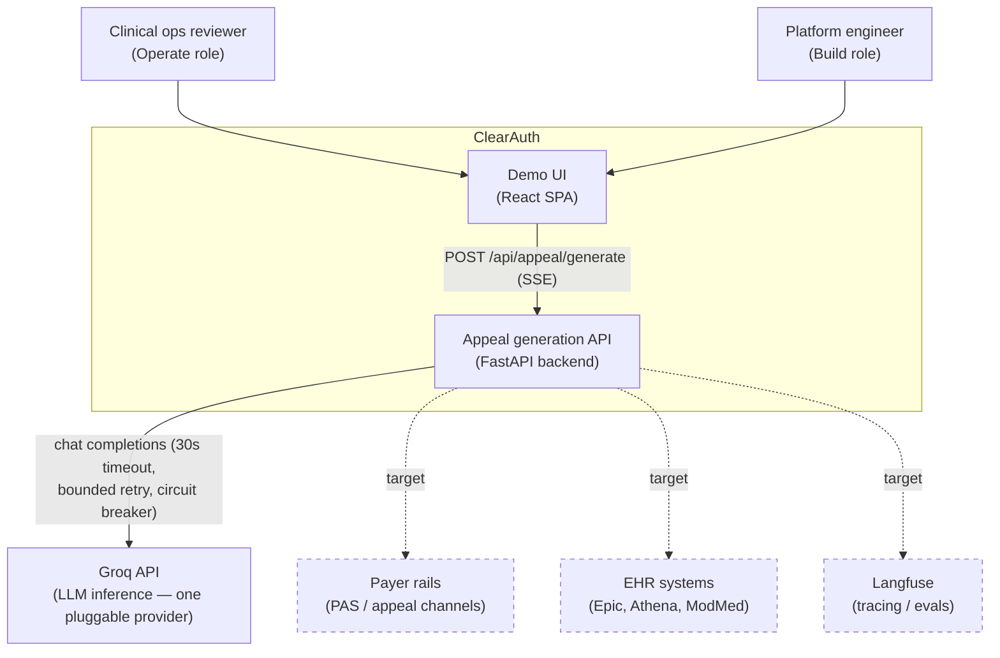

# 01 — System Overview (C4: Context & Containers)

*Verified against source 2026-07-02 (branch `project-review-hardening`).*

ClearAuth (working repo name: PaxOS demo) is a prior-authorization lifecycle
platform: it ingests denial letters, checks payer PA criteria, and generates
cited, gatekept appeal letters with a human reviewer in the loop. The repo
holds two things at once: a **polished demo UI** (scenario-driven, runs fully
offline) and a **real backend build** (FastAPI + a 4-node generation
pipeline). See [ADR-0005](adr/0005-dual-branch-strategy.md) for why.

## Level 1 — System context



Dashed = **target** (not yet integrated). The only live external dependency
today is the LLM provider, and only when `LLM_BACKEND=groq`; with
`LLM_BACKEND=mock` the system makes zero network calls
([backend/ml/mock_backend.py](../../backend/ml/mock_backend.py)).

**Trust notes:** denial letters and any payer/EHR content are untrusted input
(see [07-security-architecture.md](07-security-architecture.md)). LLM output
is also untrusted until it passes the deterministic gatekeeper
([ADR-0003](adr/0003-deterministic-gatekeeper.md)).

## Level 2 — Containers

```mermaid
flowchart TB
    subgraph frontend ["React SPA — src/ (Vite + Tailwind, TS strict)"]
        views["Role views: Operate / Build / Scale / Sponsor<br/>src/components/"]
        poc["POC live-pipeline view<br/>src/components/poc/"]
        scenarios["Scenario fixtures (offline demo data)<br/>src/data/scenarios.tsx"]
    end

    subgraph backend ["FastAPI backend — backend/"]
        main["main.py<br/>auth middleware · LLM factory · SSE routes"]
        graph["agents/graph.py<br/>pipeline orchestrator (interim hand-rolled;<br/>LangGraph target — ADR-0001)"]
        nodes["agents/nodes/<br/>ingestion · retrieval · synthesis · gatekeeper"]
        ml["ml/<br/>LLMBackend Protocol · groq · mock"]
        etl["etl/denial_letter/<br/>document → AppealRequest"]
        sec["security/<br/>sanitize · redact_phi"]
        evals["evals/<br/>structural scorer · fixtures adapter"]
    end

    subgraph data ["Data (JSON on disk today)"]
        pareq["data/pa_requirements.json"]
        golden["golden/ + evals/fixtures/scenarios.json"]
        qdrant["Qdrant vector store"]
        pg["PostgreSQL audit log"]
    end

    groq2["Groq API"]

    poc -- "SSE" --> main
    views --> scenarios
    main --> graph
    graph --> nodes
    graph --> ml
    ml --> groq2
    etl --> sec
    nodes --> pareq
    evals --> golden
    etl -. "target: upload route" .-> main
    qdrant -.-> nodes
    pg -.-> main

    style qdrant stroke-dasharray: 5 5
    style pg stroke-dasharray: 5 5
```

### Container responsibilities

| Container | Path | Responsibility | Today |
| --- | --- | --- | --- |
| Demo UI | `src/` | Role-based demo views; entirely scenario-fixture-driven; works with no backend | Live |
| POC view | `src/components/poc/` | The one UI surface that calls the real backend (SSE streaming appeal generation), with offline fallback | Live |
| API | `backend/main.py` | Bearer auth on `/api/*`, LLM backend factory, SSE framing | Live |
| Pipeline | `backend/agents/` | 4-node appeal generation with retry + security-hold gate | Live (hand-rolled; LangGraph is the target — [ADR-0001](adr/0001-langgraph-target-orchestrator.md)) |
| LLM layer | `backend/ml/` | Provider-neutral `LLMBackend` Protocol; Groq + mock implementations; circuit breaker | Live |
| ETL | `backend/etl/denial_letter/` | Untrusted document → validated `AppealRequest`; not yet exposed as an HTTP route | Live as library |
| Security | `backend/security/` | Cross-cutting: text sanitization, hidden-PDF-text detection, PHI redaction | Live |
| Evals | `backend/evals/` | Deterministic structural scoring; golden-set fixture bridge | Live |
| Vector store / DB | — | Qdrant (policy retrieval), PostgreSQL (durable audit) | Target ([10-roadmap-traceability.md](10-roadmap-traceability.md)) |

### The frontend/backend seam

The SPA is **not** a thin client over the backend. By design
([ADR-0005](adr/0005-dual-branch-strategy.md)):

- All demo views render from `src/data/scenarios.tsx` fixtures — no network.
- Only the POC pipeline flow performs a real call:
  `POST /api/appeal/generate` with `Authorization: Bearer <VITE_API_KEY>`,
  consuming the SSE stream defined in
  [06-api-contract.md](06-api-contract.md).
- Shared shapes are duplicated deliberately, with parity enforced by tests:
  `src/types.ts` ↔ `backend/models/schemas.py`
  (see [03-domain-model.md](03-domain-model.md)).

## Branches

| Branch | Purpose |
| --- | --- |
| `main` | The real build. Backend work, golden set, CI gates. |
| `demo` | The polished portfolio demo; deployed via `app.yaml` (DigitalOcean static site). |
| feature branches | TDD vertical slices (`sprint-0-golden-set-etl`, `sprint-1-wiring`, `backend-security-debt`, `project-review-hardening`), merged to `main`. |
