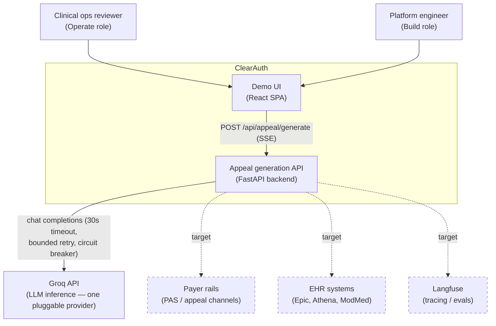
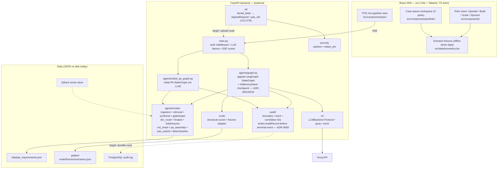

# 01 — System Overview (C4: Context & Containers)

*Verified against source 2026-07-04 (branch `sprint-3-hitl-tiering`).*

ClearAuth (working repo name: PaxOS demo) is a prior-authorization lifecycle
platform: it ingests denial letters, checks payer PA criteria, and generates
cited, gatekept appeal letters with a human reviewer in the loop. The repo
holds two things at once: a **polished demo UI** (scenario-driven, runs fully
offline) and a **real backend build** (FastAPI + a LangGraph generation
pipeline with confidence-tiered HITL routing and a resumable exception
checkpoint). See [ADR-0005](adr/0005-dual-branch-strategy.md) for why.

## Level 1 — System context

Dashed = **target** (not yet integrated). The only live external dependency
today is the LLM provider, and only when `LLM_BACKEND=groq`; with
`LLM_BACKEND=mock` the system makes zero network calls
([backend/ml/mock_backend.py](../../backend/ml/mock_backend.py)).

**Trust notes:** denial letters and any payer/EHR content are untrusted input
(see [07-security-architecture.md](07-security-architecture.md)). LLM output
is also untrusted until it passes the deterministic gatekeeper
([ADR-0003](adr/0003-deterministic-gatekeeper.md)).

## Level 2 — Containers

### Container responsibilities

| Container | Path | Responsibility | Today |
| --- | --- | --- | --- |
| Demo UI | `src/` | Role-based demo views; entirely scenario-fixture-driven; works with no backend | Live |
| Queue workspace | `src/components/portfolio/` | Three-pane case queue (case list · criteria/letter workspace · citation ground truth); pure queue/transition logic in `caseQueue.ts`, patient-context resolution in `src/data/patientContext.ts` | Live |
| POC view | `src/components/poc/` | The one UI surface that calls the real backend (SSE streaming appeal generation), with offline fallback | Live |
| API | `backend/main.py` | Bearer auth on `/api/*`, LLM backend factory, SSE framing; two live SSE routes: `POST /api/appeal/generate` and `POST /api/pa/submit`, plus `POST /api/appeal/resume` | Live |
| Appeal pipeline | `backend/agents/graph.py` (+ `generate.py`, `resume.py`) | LangGraph appeal generation: ingestion → retrieval → synthesis⇄gatekeeper (retry) → tier_router → finalize, with a security-hold gate and a resumable exception checkpoint (`interrupt`/`InMemorySaver`). `graph.py` owns the graph definition + compiled singleton; the two entrypoints that drive it — `generate.py` (`run_pipeline`) and `resume.py` (`run_resume`) — are its clients | Live (LangGraph `StateGraph` — [ADR-0001](adr/0001-langgraph-target-orchestrator.md); migrated S2 Slice 0) |
| Initial-PA pipeline | `backend/agents/initial_pa_graph.py` | Second LangGraph `StateGraph` (over `InitialPaState`), **no LLM**: pa_ingestion → crd_check → [PA required?] → pa_assembly → pas_submit → determination⟲ → finalize; submits over the stub PAS rail (`etl/pas_rail/`, X12-278 shape) | Live |
| Audit boundary | `backend/audit/` | Single interception point (`boundary.with_audit`): stamps `correlation_id` and writes exactly one `AuditRecord` to the in-memory store **before** the terminal SSE event | Live (in-memory list; [ADR-0009](adr/0009-idempotency-key-and-audit-writes.md)) |
| LLM layer | `backend/ml/` | Provider-neutral `LLMBackend` Protocol; Groq + mock implementations; circuit breaker | Live |
| ETL | `backend/etl/` | Adapters: `denial_letter/` (untrusted document → validated `AppealRequest`, not yet an HTTP route) and `pas_rail/` (canonical `PaSubmission` → X12-278, deterministic `submission_ref`) | Live as library |
| Security | `backend/security/` | Cross-cutting: text sanitization, hidden-PDF-text detection, PHI redaction | Live |
| Evals | `backend/evals/` | Deterministic structural scoring; golden-set fixture bridge | Live |
| Vector store / DB | — | Qdrant (policy retrieval), PostgreSQL (durable audit + checkpointer) | Target ([10-roadmap-traceability.md](10-roadmap-traceability.md)) |

### The frontend/backend seam

The SPA is **not** a thin client over the backend. By design
([ADR-0005](adr/0005-dual-branch-strategy.md)):

- All demo views render from `src/data/scenarios.tsx` fixtures — no network.
- Only the POC pipeline flow performs a real call:
  `POST /api/appeal/generate` with `Authorization: Bearer <VITE_API_KEY>`,
  consuming the SSE stream defined in
  [06-api-contract.md](06-api-contract.md).
- Shared shapes are duplicated deliberately, with parity enforced by tests:
  `src/types.ts` ↔ `backend/models/schemas.py`
  (see [03-domain-model.md](03-domain-model.md)).

A typed client library for the backend now exists at
[src/lib/](../../src/lib/) — a POST-SSE `fetch` reader plus route wrappers over
the generated wire types (auth is cookie/CSRF, not the POC's build-time Bearer
token). It is a **library only**: no view is wired to make live calls yet
(that integration lands in a later slice). See the *Client consumption*
section of [06-api-contract.md](06-api-contract.md).

## Branches

| Branch | Purpose |
| --- | --- |
| `main` | The real build. Backend work, golden set, CI gates. |
| `demo` | The polished portfolio demo; deployed via `app.yaml` (DigitalOcean static site). |
| feature branches | TDD vertical slices (`sprint-0-golden-set-etl`, `sprint-1-wiring`, `backend-security-debt`, `project-review-hardening`), merged to `main`. |
