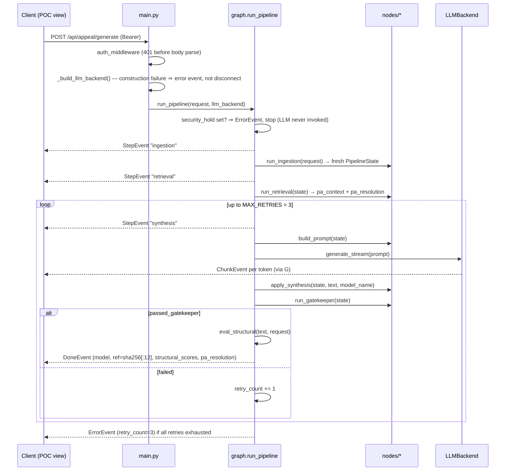

# 02 — Backend Architecture (C4: Components & Orchestration)

*Verified against source 2026-07-02 (branch `project-review-hardening`).*

The backend is layered strictly by responsibility (the layout rules live in
[CLAUDE.md](../../CLAUDE.md) §File Organization). This doc records what each
layer *is* and how a request actually moves through it.

## Layer map

```mermaid
flowchart TB
    subgraph l1 ["API layer"]
        main["main.py — routes, auth middleware, SSE framing, LLM factory"]
    end
    subgraph l2 ["Orchestration"]
        graph["agents/graph.py — run_pipeline()"]
    end
    subgraph l3 ["Nodes (pure functions over PipelineState)"]
        ing["nodes/ingestion.py"]
        ret["nodes/retrieval.py"]
        syn["nodes/synthesis.py"]
        gate["nodes/gatekeeper.py"]
        prompts["prompts.py — templates only"]
    end
    subgraph l4 ["Provider layer"]
        proto["ml/llm_backend.py — LLMBackend Protocol + CircuitBreaker"]
        groqb["ml/groq_backend.py"]
        mockb["ml/mock_backend.py"]
    end
    subgraph l5 ["Cross-cutting"]
        sec["security/ — sanitize, redact_phi"]
        errs["errors.py — typed exceptions"]
        evals["evals/ — eval_structural, fixtures"]
    end
    subgraph l6 ["Data & ingestion"]
        etl["etl/denial_letter/ — pipeline, file_detector"]
        models["models/ — schemas.py, case_packet.py"]
        pareq["data/pa_requirements.json"]
        fhi["third_party/fhi/ — forked upstream (Apache 2.0)"]
    end

    main --> graph
    graph --> ing --> ret --> syn --> gate
    syn --> prompts
    graph --> proto
    proto --- groqb
    proto --- mockb
    ret --> pareq
    graph --> evals
    etl --> sec
    etl --> models
```

Layer rules that hold today (verified in the hardening review — no violations
found): route handlers contain no business logic; nodes never import a
provider SDK; `models/` contains no logic; prompt copy lives only in
`agents/prompts.py`.

## The 4-node pipeline

`run_pipeline(request, llm_backend)` in
[backend/agents/graph.py](../../backend/agents/graph.py) is an async generator
yielding SSE events. Sequence for one request:



Node contracts (all pure — no I/O inside the function; retrieval does its file
I/O once at module load):

| Node | Contract | Does |
| --- | --- | --- |
| [ingestion.py](../../backend/agents/nodes/ingestion.py) | `(AppealRequest) → PipelineState` | Initializes state to zero values |
| [retrieval.py](../../backend/agents/nodes/retrieval.py) | `(PipelineState) → PipelineState` | PA criteria lookup: exact `plan_id` → drug-alias substring → generic fallback; records which path fired in `pa_resolution` (hard-5); never raises |
| [synthesis.py](../../backend/agents/nodes/synthesis.py) | `build_prompt(state) → str`; `apply_synthesis(state, text, model) → PipelineState` | Fills the XML-delimited template from `agents/prompts.py`; the *graph* owns the streaming loop so it can interleave ChunkEvents (hard-9) |
| [gatekeeper.py](../../backend/agents/nodes/gatekeeper.py) | `(PipelineState) → PipelineState` | Deterministic checks, in order: length ≥ 300 chars, drug present, diagnosis present, no refusal/AI-identity phrases. Sets `passed_gatekeeper`, appends `errors` |

Two boundary guarantees added in the hardening pass
([docs/project-review-hardening.md](../project-review-hardening.md)):

1. **Security-hold enforcement (hard-1):** a request with
   `security_hold=True` (set by ETL on suspicious documents) terminates with a
   single `ErrorEvent` before any node runs — the LLM is never invoked.
2. **Guaranteed terminal event (hard-2):** `run_pipeline` wraps the body in
   the one deliberate broad catch in the codebase, because SSE headers are
   already sent — every stream ends in `done` or `error`, never a bare
   disconnect. Detail is logged server-side (identifiers only, PHI rule);
   clients get a generic message.

## Orchestration: interim vs target

> **This is the section that answers "who orchestrates the DAG?"**
> Full decision record: [ADR-0001](adr/0001-langgraph-target-orchestrator.md).

**Current (interim):** `agents/graph.py` is a hand-rolled async generator —
plain sequential calls plus a retry loop. It exists in this form because the
current topology is linear, SSE interleaving is trivial to hand-roll, and the
hardening pass deliberately removed unused dependencies (`langgraph` among
them, chore-11) rather than carry an unexercised framework.

**Target:** **LangGraph is the committed orchestrator.** The migration
trigger is the TierRouter node (tiered HITL routing: routine / complex /
exception), which introduces conditional edges, checkpointing, and
human-in-the-loop interrupts — exactly what `StateGraph` provides and a
hand-rolled loop starts to reimplement badly. Planned for Sprint 2/3.

The migration is cheap **by construction**: every node is already a pure
`(state) → state` function over the `PipelineState` TypedDict — LangGraph's
native node shape. Adopting it means re-wiring `graph.py`
(`StateGraph(PipelineState)` + `add_node`/`add_edge`), not rewriting nodes.
**Do not add orchestration logic (branching, persistence, interrupts) to the
hand-rolled loop — that work belongs to the LangGraph migration.**

## Patterns in force

- **Strategy — LLM providers.** Nodes and graph code against the
  `LLMBackend` Protocol ([ml/llm_backend.py](../../backend/ml/llm_backend.py));
  `main.py`'s factory is the only place a provider is named. No default
  provider — `LLM_BACKEND` must be explicit
  ([ADR-0002](adr/0002-provider-neutral-llm-backend.md)).
- **Adapter — data sources.** `etl/denial_letter/` translates untrusted
  documents into the canonical `AppealRequest`;
  `evals/fixtures_adapter.py` translates `EvalScenario` fixtures into
  `AppealRequest`/`ScenarioConfig`. Downstream code never branches on source
  format.
- **Circuit breaker — external calls.** `CircuitBreaker` (3 consecutive
  failures → open, 30s cooldown → probe) is the shared primitive every remote
  provider must use; Groq wires it around both `generate` and
  `generate_stream`, with a 30s request timeout and 2 SDK retries.

## Typed exceptions

[backend/errors.py](../../backend/errors.py): `ETLParseError`,
`GatekeeperError`, `ContextWindowError`, `RefusalDetectedError`,
`LLMUnavailableError` (circuit open). Domain errors subclass these — never
bare `Exception`. The only broad catches are the two SSE boundary wraps noted
above, which convert failures into `ErrorEvent`s rather than hiding them.
