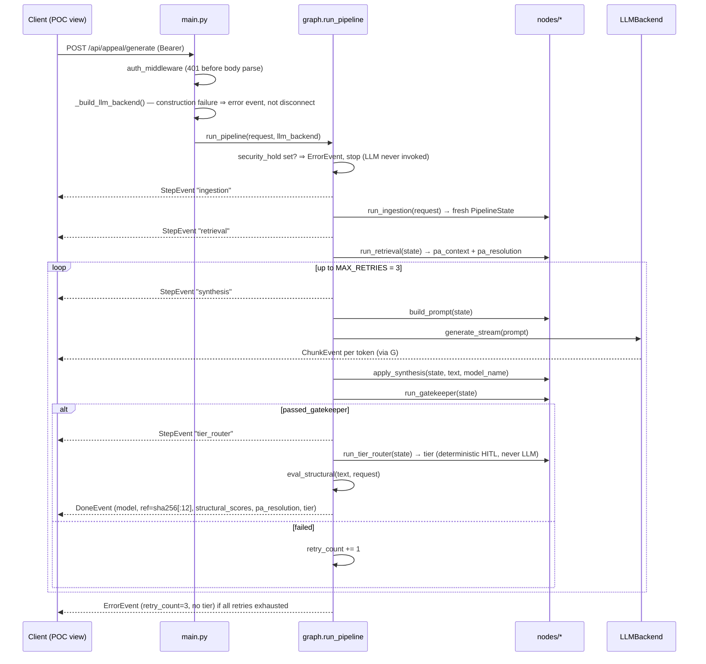

# 02 — Backend Architecture (C4: Components & Orchestration)

*Verified against source 2026-07-02 (branch `project-review-hardening`).*

The backend is layered strictly by responsibility (the layout rules live in
[CLAUDE.md](../../CLAUDE.md) §File Organization). This doc records what each
layer *is* and how a request actually moves through it.

## Layer map

```mermaid
flowchart TB
    subgraph l1 ["API layer"]
        main["main.py — routes, auth middleware, SSE framing, LLM factory"]
    end
    subgraph l2 ["Orchestration"]
        graph["agents/graph.py — run_pipeline()"]
    end
    subgraph l3 ["Nodes (pure functions over PipelineState)"]
        ing["nodes/ingestion.py"]
        ret["nodes/retrieval.py"]
        syn["nodes/synthesis.py"]
        gate["nodes/gatekeeper.py"]
        prompts["prompts.py — templates only"]
    end
    subgraph l4 ["Provider layer"]
        proto["ml/llm_backend.py — LLMBackend Protocol + CircuitBreaker"]
        groqb["ml/groq_backend.py"]
        mockb["ml/mock_backend.py"]
    end
    subgraph l5 ["Cross-cutting"]
        sec["security/ — sanitize, redact_phi"]
        errs["errors.py — typed exceptions"]
        evals["evals/ — eval_structural, fixtures"]
    end
    subgraph l6 ["Data & ingestion"]
        etl["etl/denial_letter/ — pipeline, file_detector"]
        models["models/ — schemas.py, case_packet.py"]
        pareq["data/pa_requirements.json"]
        fhi["third_party/fhi/ — forked upstream (Apache 2.0)"]
    end

    main --> graph
    graph --> ing --> ret --> syn --> gate
    syn --> prompts
    graph --> proto
    proto --- groqb
    proto --- mockb
    ret --> pareq
    graph --> evals
    etl --> sec
    etl --> models
```

Layer rules that hold today (verified in the hardening review — no violations
found): route handlers contain no business logic; nodes never import a
provider SDK; `models/` contains no logic; prompt copy lives only in
`agents/prompts.py`.

## The appeal pipeline

`run_pipeline(request, llm_backend)` in
[backend/agents/graph.py](../../backend/agents/graph.py) is an async generator
yielding SSE events. Since Sprint 2 Slice 0 it executes a LangGraph
`StateGraph(PipelineState)` under the hood (see the orchestration section
below); the event sequence for one request adds only the `tier_router` step
on the gatekeeper-pass path (S3 Slice 3):



Node contracts (all pure — no I/O inside the function; retrieval does its file
I/O once at module load):

| Node | Contract | Does |
| --- | --- | --- |
| [ingestion.py](../../backend/agents/nodes/ingestion.py) | `(AppealRequest) → PipelineState` | Initializes state to zero values |
| [retrieval.py](../../backend/agents/nodes/retrieval.py) | `(PipelineState) → PipelineState` | PA criteria lookup: exact `plan_id` → drug-alias substring → generic fallback; records which path fired in `pa_resolution` (hard-5); never raises |
| [synthesis.py](../../backend/agents/nodes/synthesis.py) | `build_prompt(state) → str`; `apply_synthesis(state, text, model) → PipelineState` | Fills the XML-delimited template from `agents/prompts.py`; the *graph* owns the streaming loop so it can interleave ChunkEvents (hard-9) |
| [gatekeeper.py](../../backend/agents/nodes/gatekeeper.py) | `(PipelineState) → PipelineState` | Deterministic checks, in order: length ≥ 300 chars, drug present, diagnosis present, no refusal/AI-identity phrases. Sets `passed_gatekeeper`, appends `errors`. Owns `MAX_RETRIES` (the graph's conditional edge and the tier router both import it) |
| [tier_router.py](../../backend/agents/nodes/tier_router.py) | `decide_tier(TierSignals) → CaseTier`; `(PipelineState) → PipelineState` | **Deterministic HITL tier routing (S3 Slice 2) — never an LLM deciding tier** (Illinois, MD HB 1563). Routine = all criteria confidence ≥ 0.95 + first-pass gatekeeper; complex = any [0.70, 0.95), counter-offer, `drug_alias` resolution (first drug/plan pairing), or passed-after-retries; exception = any < 0.70/unassessed/no criteria, gatekeeper exhausted, novel denial reason, or `pa_resolution == "generic"` (the hard-5 signal's consumer). Exception > complex. Sets `PipelineState.tier`. **Wired (S3 Slice 3):** the gatekeeper-pass conditional edge routes `gatekeeper → tier_router → finalize`, and `tier` rides the `DoneEvent` + `AuditRecord`. The exhausted path carries no tier (no letter produced) |

## The initial-PA pipeline (S2)

`run_initial_pa_pipeline(request)` in
[backend/agents/initial_pa_graph.py](../../backend/agents/initial_pa_graph.py)
is a second `StateGraph` (over `InitialPaState`) for the initial-PA
lifecycle: `pa_ingestion → crd_check → [PA required?] → pa_assembly →
pas_submit → determination ⟲ → finalize`, with a conditional early exit
when no PA requirement is on file and a bounded pended self-loop on
determination (a pend re-enters determination only — it never re-submits).
**No LLM backend parameter — this path never invokes a model**; its event
union has no `chunk` member.

| Node | Contract | Does |
| --- | --- | --- |
| [pa_ingestion.py](../../backend/agents/nodes/pa_ingestion.py) | `(InitialPaRequest) → InitialPaState` | Initializes state to zero values |
| [crd_check.py](../../backend/agents/nodes/crd_check.py) | `(InitialPaState) → InitialPaState` | `derive_pa_required` (pure rule): registry hit ⇒ required with basis; miss ⇒ `required=False` "no PA requirement on file". **Stub CRD — the registry stands in for the payer's CRD endpoint and fails open on registry gaps**; a real payer query replaces the lookup |
| [pa_assembly.py](../../backend/agents/nodes/pa_assembly.py) | `build_submission(request, pa_context) → PaSubmission` | Canonical structured PA request; the rail shape is the adapter's job |
| [pas_submit.py](../../backend/agents/nodes/pas_submit.py) | `(InitialPaState) → InitialPaState` | Transmits via [etl/pas_rail/adapter.py](../../backend/etl/pas_rail/adapter.py) — canonical in, X12-278 shape out, deterministic `submission_ref` (a retry never mints a second rail identity). Rail-accurate: appeals never ride PAS |
| [determination.py](../../backend/agents/nodes/determination.py) | `derive_determination(evidence, pend_cycles, ref) → PaOutcome` | Deterministic evidence-based stub: all-found ⇒ approved; empty/needs_review ⇒ pended (bounded loop, `MAX_PEND_CYCLES=1`); conflict ⇒ denied ⇒ `make_appeal_handoff` pointer (human-gated, never auto-launches the appeal) |

The registry lookup itself (plan_id → drug-alias → generic + validated pack
loader) lives in
[agents/requirements_lookup.py](../../backend/agents/requirements_lookup.py),
extracted from the retrieval node when CRD became its second consumer
(CLAUDE.md DRY). Both lifecycles share the security-hold gate semantics and
the `done`|`error` terminal guarantee.

Two boundary guarantees added in the hardening pass
([docs/project-review-hardening.md](../project-review-hardening.md)):

1. **Security-hold enforcement (hard-1):** a request with
   `security_hold=True` (set by ETL on suspicious documents) terminates with a
   single `ErrorEvent` before any node runs — the LLM is never invoked.
2. **Guaranteed terminal event (hard-2):** `run_pipeline` wraps the body in
   the one deliberate broad catch in the codebase, because SSE headers are
   already sent — every stream ends in `done` or `error`, never a bare
   disconnect. Detail is logged server-side (identifiers only, PHI rule);
   clients get a generic message.

## Orchestration: LangGraph StateGraph (live since Sprint 2 Slice 0)

> **This is the section that answers "who orchestrates the DAG?"**
> Full decision record: [ADR-0001](adr/0001-langgraph-target-orchestrator.md)
> — executed 2026-07-02, behavior-preserving (the pre-migration 425-test suite
> passed unmodified).

`agents/graph.py` compiles a `StateGraph(PipelineState)` once at import and
runs it per request. Design points:

- **Wrapper nodes own event emission, nothing else.** Each graph node is a
  thin async wrapper that writes `StepEvent`/`ChunkEvent` to LangGraph's
  custom stream channel (`get_stream_writer()`) and delegates all logic to
  the untouched pure functions in `agents/nodes/`. `run_pipeline` forwards
  the custom stream — its public signature and the SSE event contract are
  identical to the pre-migration implementation.
- **The synthesis→gatekeeper retry loop is a conditional edge**
  (`_after_gatekeeper`: passed → `tier_router`, failed & retries left →
  `synthesis`, exhausted → `exhausted`). On a pass, `tier_router` (S3 Slice 3,
  deterministic HITL) runs before `finalize`, which emits the `DoneEvent`
  carrying the review `tier`; `exhausted` emits the terminal `ErrorEvent` with
  `retry_count=3` and no tier (no letter was produced).
- **`llm_backend` is injected via `config["configurable"]`**, not captured in
  a closure — the compiled graph is a module-level singleton; per-run state
  isolation (ACID §Isolation) holds because there is no checkpointer.
- **Boundary guarantees carry over:** the `security_hold` gate runs in
  `run_pipeline` before the graph is invoked (LLM never constructed into a
  node call for held requests), and the one deliberate broad catch still
  converts any node exception into a terminal `error` event.
- **Checkpointing/interrupts are deliberately not enabled yet** — that is the
  Sprint 3 exception-queue slice. `langgraph-checkpoint` is floor-pinned
  (`>=3.0`, CVE-2025-67644) but no checkpointer is configured.
- **LangSmith stays dark.** `langsmith` arrives as a mandatory transitive of
  `langchain-core`; `main.py` force-sets `LANGSMITH_TRACING` /
  `LANGCHAIN_TRACING_V2` to `"false"` after `load_dotenv()` so PHI trace
  payloads can never leave the process via a stray env var
  (test: `tests/unit/test_telemetry_disabled.py`). Planned observability
  remains self-hosted Langfuse.

## Patterns in force

- **Strategy — LLM providers.** Nodes and graph code against the
  `LLMBackend` Protocol ([ml/llm_backend.py](../../backend/ml/llm_backend.py));
  `main.py`'s factory is the only place a provider is named. No default
  provider — `LLM_BACKEND` must be explicit
  ([ADR-0002](adr/0002-provider-neutral-llm-backend.md)).
- **Adapter — data sources.** `etl/denial_letter/` translates untrusted
  documents into the canonical `AppealRequest`;
  `evals/fixtures_adapter.py` translates `EvalScenario` fixtures into
  `AppealRequest`/`ScenarioConfig`. Downstream code never branches on source
  format.
- **Circuit breaker — external calls.** `CircuitBreaker` (3 consecutive
  failures → open, 30s cooldown → probe) is the shared primitive every remote
  provider must use; Groq wires it around both `generate` and
  `generate_stream`, with a 30s request timeout and 2 SDK retries.

## Typed exceptions

[backend/errors.py](../../backend/errors.py): `ETLParseError`,
`GatekeeperError`, `ContextWindowError`, `RefusalDetectedError`,
`LLMUnavailableError` (circuit open). Domain errors subclass these — never
bare `Exception`. The only broad catches are the two SSE boundary wraps noted
above, which convert failures into `ErrorEvent`s rather than hiding them.
