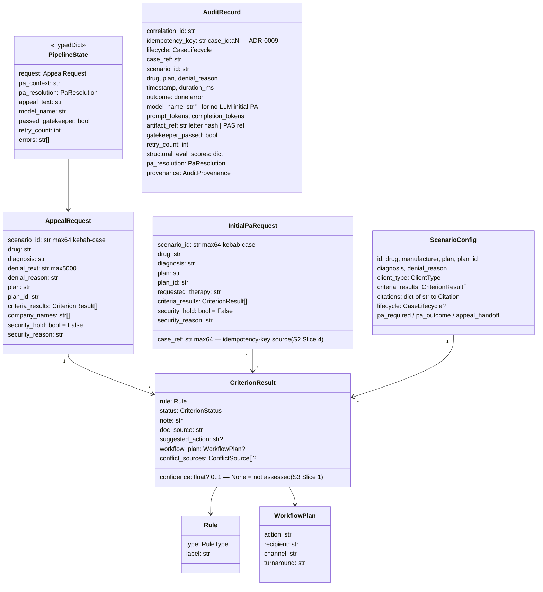
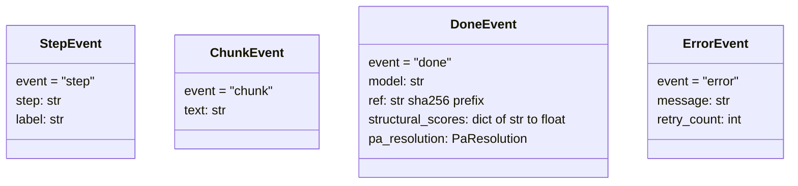
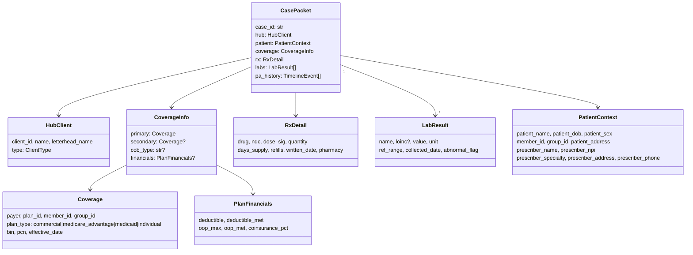

# 03 — Domain Model

*Verified against source 2026-07-02 (branch `project-review-hardening`).*

All backend data contracts are Pydantic models in
[backend/models/schemas.py](../../backend/models/schemas.py) (pipeline-facing)
and [backend/models/case_packet.py](../../backend/models/case_packet.py)
(enriched case record), plus the eval-side schema in
[backend/evals/fixtures/schema.py](../../backend/evals/fixtures/schema.py).
Per CLAUDE.md, types are never redefined inline — these files are the single
source of truth.

## Pipeline-facing entities

Notes:

- **`AppealRequest`** is strict-mode (`ConfigDict(strict=True)`) with
  max-length constraints — the validated HTTP boundary. `security_hold` /
  `security_reason` are set by the ETL, not expected from clients.
- **`InitialPaRequest`** (S2 Slice 1, spec-first) is the initial-PA
  lifecycle's own strict request — deliberately **not** an `AppealRequest`
  extension: an initial PA precedes any payer decision (no denial fields),
  and it drives a different artifact on a different rail (CRD → assemble →
  PAS). `case_ref` is the case identifier a denied PA's appeal continues
  (`AppealHandoff.case_ref`) and the source of the Slice 4 idempotency key
  (falls back to `scenario_id` when empty). The `security_hold` pair carries
  over so the pipeline gate enforces it for both lifecycles.
- **`CriterionResult.confidence`** (S3 Slice 1, spec-first) is the 0–1
  confidence that the finding is correct **and complete enough to act on
  without human input** — the signal the S3 TierRouter bands route against
  (≥0.95 routine, 0.70–0.94 complex, <0.70 exception). `None` means "not
  assessed" and routes to exception — the default is honest, never an
  implicit 1.0. Golden labels: `ScenarioCriterion.confidence` is *required*
  (scenarios.json 0.4); the labeling rubric lives on the field in
  `evals/fixtures/schema.py`. Distinct from `ExpectedOutcome.confidence`,
  which is the qualitative case-level appeal-strength label.
- **`PipelineState`** is the LangGraph-shaped TypedDict every node maps over.
  It is per-run and never shared (CLAUDE.md ACID §Isolation).
- **`InitialPaState`** (S2 Slice 2) is the initial-PA graph's TypedDict —
  full lifecycle shape spec-first: `pa_required`/`pa_context`/`pa_resolution`
  set by `crd_check`, `submission: PaSubmission | None` by `pa_assembly`,
  `submission_ref`/`outcome`/`appeal_handoff` filled by the Slice 3 nodes.
- **`PaSubmission`** (S2 Slice 2) is the canonical structured PA request the
  assembly node produces (case_ref, drug/diagnosis/plan_id,
  requested_therapy, criteria evidence, CRD-resolved pa_context). Canonical
  only — the PAS/X12-278 rail shape comes from the rail adapter (adapter
  pattern; engine never branches on payer/rail).
- **`ScenarioConfig`** is the rich scenario shape shared with the frontend
  demo — appeal scenarios plus optional initial-PA lifecycle fields
  (`pa_required`, `requested_therapy`, `pa_outcome`, `appeal_handoff`,
  `payer_response_analysis`) and multi-round appeal fields
  (`payer_counter_offer`, `round2_appeal`).
- **`AuditRecord`** is **written at both pipeline boundaries since S2
  Slice 4** ([ADR-0009](adr/0009-idempotency-key-and-audit-writes.md)):
  every run — done or error, either lifecycle, including security holds —
  writes exactly one record to the in-memory store (`audit/store.py`)
  before the terminal SSE event, idempotent on `idempotency_key` =
  `case_id:aN`. `provenance` is `as_is` for all boundary writes today
  (gatekeeper-corrected / human-edited paths arrive in S3/S4). Durable
  persistence remains the PostgreSQL milestone
  ([10-roadmap-traceability.md](10-roadmap-traceability.md)).

## SSE events (discriminated union `AppealEvent`)

The initial-PA stream (S2 Slice 1, spec-first) shares `StepEvent`/`ErrorEvent`
and the terminal guarantee, but its success terminal is
**`InitialPaDoneEvent`** (`event: "done"`): `pa_required: PaRequired`,
`outcome: PaOutcome | None` (None ⇔ CRD early exit), `appeal_handoff:
AppealHandoff | None` (present iff denied), `submission_ref` (PAS rail),
`pa_resolution`. `InitialPaEvent = StepEvent | InitialPaDoneEvent |
ErrorEvent` — **no `chunk` member**: there is no LLM in the initial-PA path;
the denied→appeal handoff is a pointer, and launching the appeal stays a
separate human-gated request.

Exact wire format in [06-api-contract.md](06-api-contract.md).

## Enriched case record (CasePacket)

The golden-set output model — the unit of work for eval and appeal
generation. Not yet wired into the live pipeline.

`PatientContext` is the one legitimate PHI sink (synthetic-by-construction in
the golden set, drawn from the closed `IDENTITY_POOL`); everything else must
pass through `redact_phi()` before leaving the process
([07-security-architecture.md](07-security-architecture.md)).

## Eval-side entities

`EvalScenario` ([evals/fixtures/schema.py](../../backend/evals/fixtures/schema.py))
is the canonical labeled record for one PA denial case — the shape of
[evals/fixtures/scenarios.json](../../backend/evals/fixtures/scenarios.json)
(currently 6 scenarios over 3 anchors: 3 `clinical_pa`, 1 `coding_error`,
2 `redteam`).

Key fields: `anchor_id`, `denial_type` (clinical_pa | coding_error |
administrative | redteam), `policy_refs`, `submitted_codes` vs
`policy_expected_codes`, `discrepancy_signals` (verbatim policy statements,
`human_action_required`), `criteria` (with `ground_truth_status` and
claim→span `GroundingRef`), `expected_outcome` (appealable, resolution path,
expected defensive behavior for redteam), `eval_dimensions`
(coverage | structure | safety | claim_citation | over_caution).

**The bridge:** [evals/fixtures_adapter.py](../../backend/evals/fixtures_adapter.py)
converts `EvalScenario` → `AppealRequest` / `ScenarioConfig` so the same
golden data drives retrieval packs, tests, and the demo UI — one dataset,
adapted per consumer, never duplicated (CLAUDE.md DRY).

## Enums

| Enum | Values | Home |
| --- | --- | --- |
| `CaseStatus` | processing, ready_for_review, exception, awaiting_documentation, submitted, payer_response | schemas.py ↔ types.ts (parity: hard-3) |
| `CaseLifecycle` | initial_pa, appeal | schemas.py ↔ types.ts (parity-tested since S2 Slice 1) |
| `PaDecision` | approved, pended, denied | schemas.py ↔ types.ts (parity: S2 Slice 1); `PaOutcome.decision` |
| `AuditProvenance` | as_is, gatekeeper_corrected, human_edited | schemas.py ↔ types.ts (parity: S2 Slice 4); `AuditRecord.provenance` |
| `CaseTier` | routine, complex, exception | schemas.py ↔ types.ts (parity: S3 Slice 2); assigned by `agents/nodes/tier_router.py` — deterministic, never an LLM; `PipelineState.tier` (None until the node runs) |
| `RuleType` | diagnostic, temporal, math, safety, provider, quantity, custom | schemas.py ↔ types.ts |
| `CriterionStatus` | found, needs_review, conflict | schemas.py ↔ types.ts |
| `ClientType` | medtech, patient | schemas.py ↔ types.ts |
| `EvalDimension` | coverage, structure, safety, claim_citation, over_caution | evals/fixtures/schema.py (frontend rubric uses hyphenated twins) |
| `FileType` | pdf, image, text | etl/denial_letter/file_detector.py |
| Frontend-only | `View`, `Role`, `SimPhase`, `Urgency`, `EvalMethodology` | src/types.ts |

## Frontend parity contract

`src/types.ts` mirrors `backend/models/schemas.py` field-for-field (camelCase
aliases on the Pydantic side). Drift is a build-breaker, enforced from both
directions:

- `src/data/scenarios_parity.test.ts` — anchor-join parity guard (Vitest, runs in CI)
- `backend/tests/unit/test_schema_parity.py` — enum-shape parity (added in hard-3)

Rule of thumb: **changing a shared shape is a two-file change plus a parity
test update, in the same commit.**

## Glossary

| Term | Meaning |
| --- | --- |
| **PA** | Prior authorization — payer approval required before a therapy is covered. |
| **Initial PA vs appeal** | Two lifecycle stages (`CaseLifecycle`): assembling/transmitting a new PA request (Da Vinci CRD → DTR → PAS rails) vs contesting a denial (appeal channel). Different artifacts, different transmission rails. |
| **Anchor** | One drug × payer × policy combination the golden set is built around (`ozempic_cigna`, `esomeprazole_uhc_pediatric`, `livdelzi_cigna_hepatology`). Scenarios derive from anchors. |
| **Golden set** | The canonical, provenance-tracked dataset under `backend/golden/` + `evals/fixtures/scenarios.json` — see [/docs/golden-set-governance.md](../golden-set-governance.md) and [ADR-0004](adr/0004-golden-set-canonical-dataset.md). |
| **plan_id** | Payer plan identifier (e.g. `CIGNA-CNF360-2024`) — the most specific PA-policy lookup key. Cigna market segments: `cnf_` (nonformulary), `ip_NNN` (employer PDL), `ip_NNN_ifp` (individual/ACA). |
| **Drug alias** | Alternate names for a drug (brand/generic) used as the retrieval fallback when `plan_id` doesn't match. |
| **pa_resolution** | Which retrieval path produced the PA context: `plan_id` (payer-specific), `drug_alias` (fallback), `generic` (boilerplate). A generic-fallback letter is a materially different artifact — this is audit-relevant (hard-5). |
| **BIN/PCN/Group** | Pharmacy-claim routing identifiers; the Sprint 5 hook for coverage-driven pack resolution via `golden/coverage_pool.json`. |
| **COB** | Coordination of benefits — primary plan governs PA; Medicaid is always payer of last resort. |
| **Security hold** | ETL-set flag on a request whose source document showed injection phrases, bidi characters, or hidden PDF text. Enforced at the pipeline gate (hard-1). |
| **Gatekeeper** | The deterministic post-generation check node — not an LLM ([ADR-0003](adr/0003-deterministic-gatekeeper.md)). |
