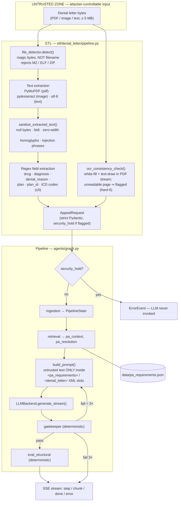
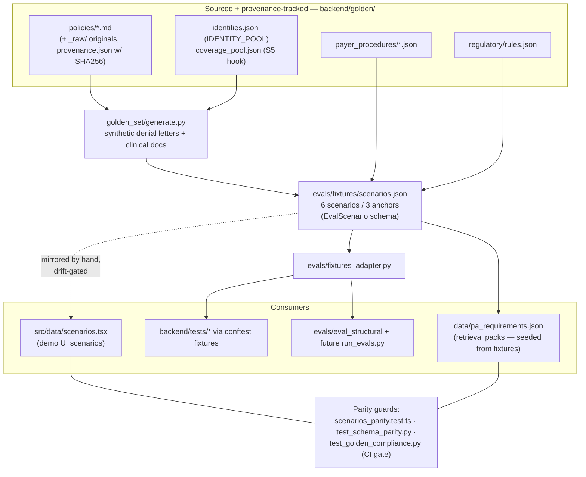

# 04 — Data Flow & Trust Boundaries

*Verified against source 2026-07-02 (branch `project-review-hardening`).*

Two flows matter: the **live appeal-generation path** (untrusted document in,
gatekept letter out) and the **golden-set supply chain** (how canonical data
reaches retrieval, tests, evals, and the demo UI).

## Flow 1 — Appeal generation (live path)

### Trust boundaries on this path

| # | Boundary | Control | Where |
| --- | --- | --- | --- |
| 1 | Bytes → typed file | Magic-byte detection, executable rejection, 5 MB cap, empty-input rejection | [file_detector.py](../../backend/etl/denial_letter/file_detector.py), [pipeline.py](../../backend/etl/denial_letter/pipeline.py) |
| 2 | Extracted text → clean text | Sanitization + PhantomLint hidden-text check; anything suspicious sets `security_hold` | [sanitize.py](../../backend/security/sanitize.py) |
| 3 | Request → pipeline | Strict Pydantic validation at HTTP boundary; security-hold gate before any node (hard-1) | [schemas.py](../../backend/models/schemas.py), [graph.py](../../backend/agents/graph.py) |
| 4 | Untrusted text → prompt | XML-delimited slots only — never raw interpolation | [prompts.py](../../backend/agents/prompts.py), [synthesis.py](../../backend/agents/nodes/synthesis.py) |
| 5 | LLM output → downstream | Deterministic gatekeeper before any use ([ADR-0003](adr/0003-deterministic-gatekeeper.md)) | [gatekeeper.py](../../backend/agents/nodes/gatekeeper.py) |
| 6 | Anything → logs/traces | `redact_phi()` before any external sink; pipeline logs identifiers only | [redact.py](../../backend/security/redact.py) |

The full threat analysis lives in
[07-security-architecture.md](07-security-architecture.md).

**Gap to know about:** the ETL is currently a library
(`process_denial_letter(raw_bytes, filename)`) — no upload HTTP route exists
yet. When one is added it inherits the pipeline-level security-hold gate, but
must add its own auth + upload limits (see
[10-roadmap-traceability.md](10-roadmap-traceability.md)).

## Flow 2 — Golden-set supply chain

One canonical dataset feeds everything; adapters translate, nothing is
hand-duplicated (CLAUDE.md DRY; governance in
[/docs/golden-set-governance.md](../golden-set-governance.md)).

### Retrieval resolution (where Flow 2 meets Flow 1)

[retrieval.py](../../backend/agents/nodes/retrieval.py) loads
`data/pa_requirements.json` **once at module import** (validated pack-by-pack;
malformed packs raise `ETLParseError`), building two lookup tables:

1. `plan_id` → criteria_text — exact match, most specific (`pa_resolution="plan_id"`)
2. drug alias (lowercased) → criteria_text — substring match on the request's drug (`pa_resolution="drug_alias"`)
3. neither → generic boilerplate (`pa_resolution="generic"`) — never raises

The fired path travels through `PipelineState.pa_resolution` to
`DoneEvent.pa_resolution` so the audit trail can distinguish a payer-specific
letter from a generic-fallback one (hard-5). Sprint 5 extends resolution to
BIN/PCN/Group + market + tier via `golden/coverage_pool.json`.
