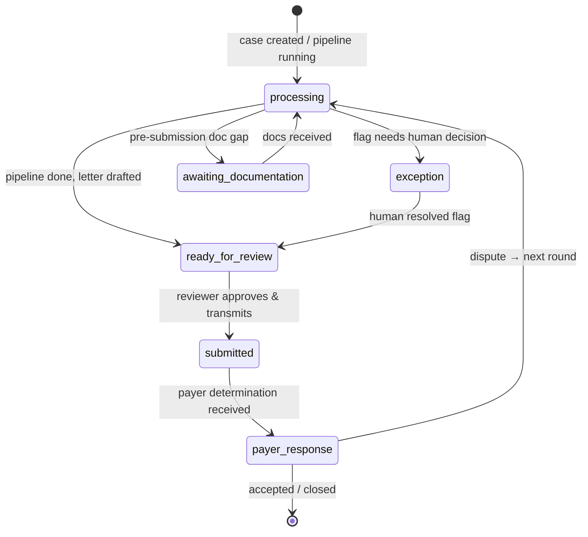
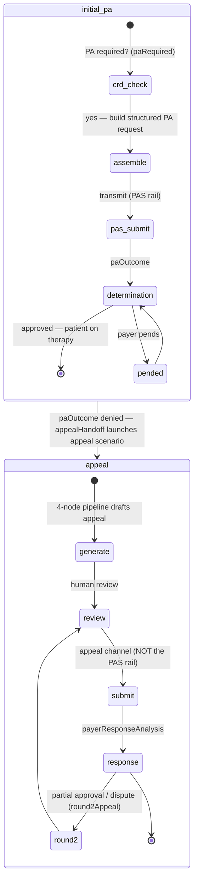
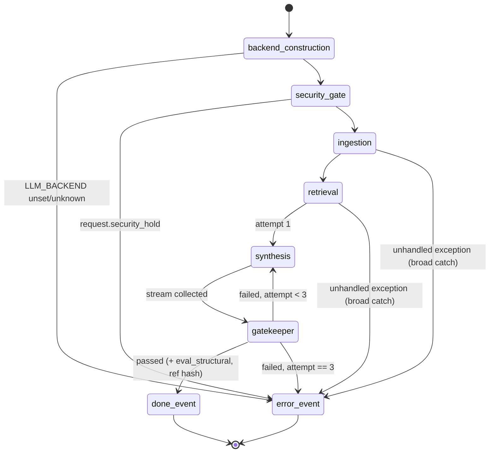
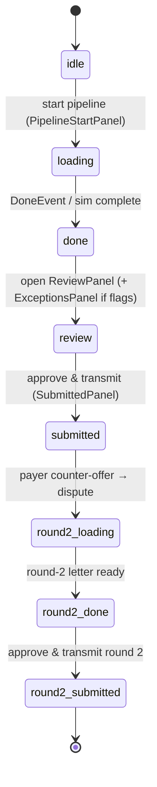

# 05 — State Machines & Lifecycles

*Verified against source 2026-07-02 (branch `project-review-hardening`).*

Four state machines matter, at different altitudes: the **case** (business
state, shared enum), the **case lifecycle** (initial PA vs appeal), the
**pipeline run** (one SSE request), and the **frontend POC simulation**
(`SimPhase`).

## CaseStatus — business state of a case

Enum: `backend/models/schemas.py` ↔ `src/types.ts` (parity-tested, hard-3).

Semantics worth pinning:

- **`awaiting_documentation` ≠ denial.** It is a *pre-submission* gap (the
  PH-3101 flow — e.g. missing chart note before the PA can even be filed),
  not a payer response. Modeling it as an exception hid the distinction.
- **`exception`** means the AI surfaced something a human must decide
  (conflicting sources, needs-review criterion) — the tiered-HITL routing
  target for the TierRouter ([ADR-0001](adr/0001-langgraph-target-orchestrator.md)).
- Queue prioritization (frontend `Urgency`: today / soon / later) is derived
  from regulatory turnaround deadlines, orthogonal to `CaseStatus`.

## CaseLifecycle — which artifact is being produced

The two stages use **different transmission rails** — PAS for initial PA,
appeal channels for appeals — so artifacts must be rail-accurate. A denied
initial PA hands off to the appeal flow via `appealHandoff` (same patient,
continuing case reference). Absence of `lifecycle` on a scenario means
`appeal` (the original demo scenarios).

## Pipeline run — one `POST /api/appeal/generate`

Source: [backend/agents/graph.py](../../backend/agents/graph.py). Terminal
states are exactly `done` and `error` — guaranteed
([ADR-0006](adr/0006-sse-streaming-transport.md)).

Retry semantics: only the **synthesis → gatekeeper** pair retries
(`MAX_RETRIES = 3`); ingestion/retrieval failures are not retried (retrieval
by design cannot fail — generic fallback). `retry_count` rides along in
`PipelineState` and is reported on the terminal `ErrorEvent`.

## SimPhase — frontend POC flow

Type: `src/types.ts`; driven by the POC panels in `src/components/poc/`.
This is UI presentation state, not backend state — it maps SSE events (or the
offline simulation) onto panels.

## Cross-machine mapping

| Pipeline outcome | SSE terminal | CaseStatus effect | SimPhase effect |
| --- | --- | --- | --- |
| Gatekeeper passed | `done` | processing → ready_for_review | loading → done |
| Security hold | `error` | → exception (human review of the document) | loading → error banner |
| Retries exhausted / node exception | `error` | stays processing / manual retry | loading → error banner |
| Reviewer approves | — | ready_for_review → submitted | review → submitted |
| Payer counter-offer | — | payer_response → processing (round 2) | submitted → round2_loading |
