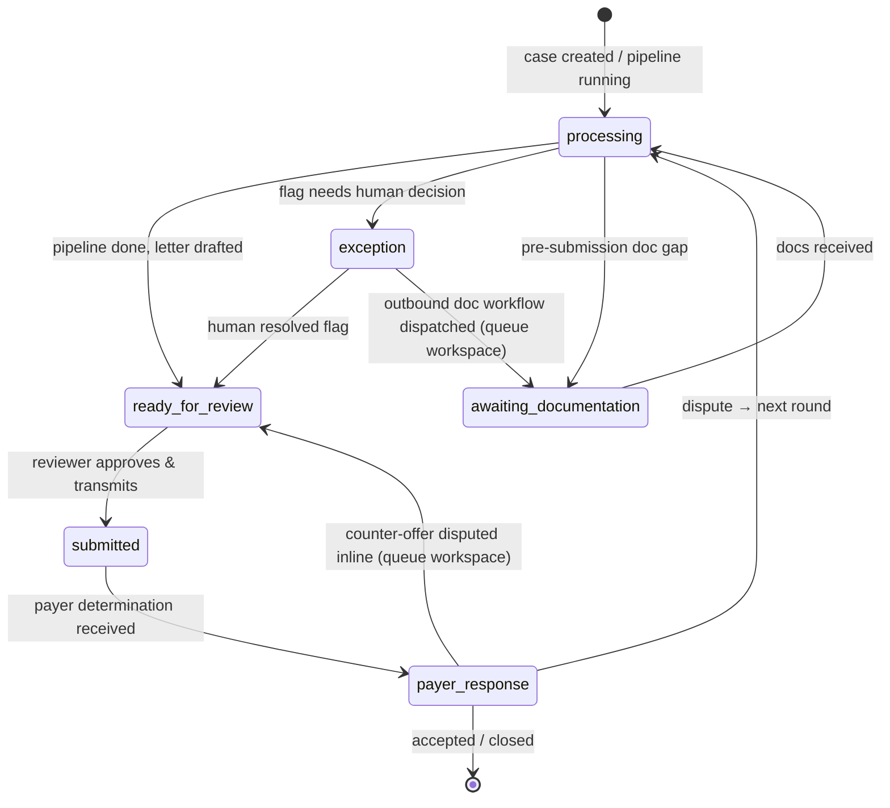
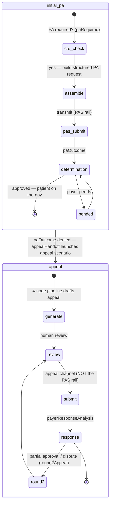
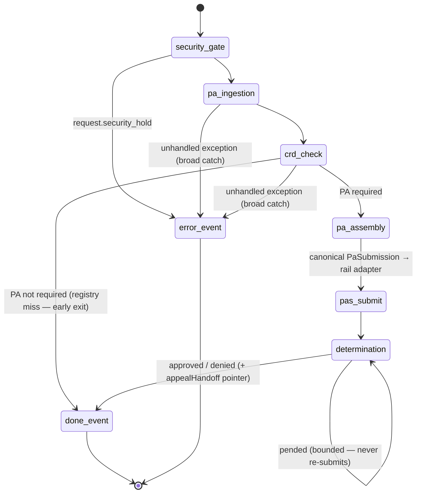
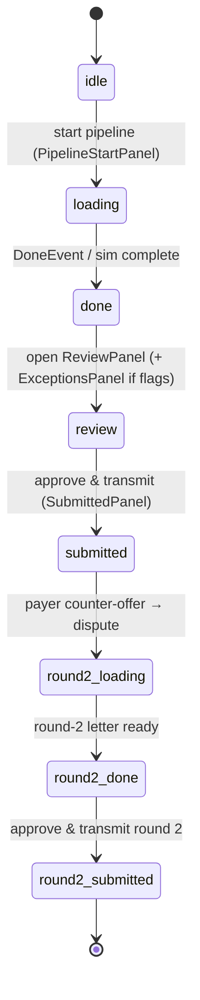

# 05 — State Machines & Lifecycles

*Verified against source 2026-07-02 (branch `project-review-hardening`).*

Four state machines matter, at different altitudes: the **case** (business
state, shared enum), the **case lifecycle** (initial PA vs appeal), the
**pipeline run** (one SSE request), and the **frontend POC simulation**
(`SimPhase`).

## CaseStatus — business state of a case

Enum: `backend/models/schemas.py` ↔ `src/types.ts` (parity-tested, hard-3).

Semantics worth pinning:

- **`awaiting_documentation` ≠ denial.** It is a *pre-submission* gap (the
  PH-3101 flow — e.g. missing chart note before the PA can even be filed),
  not a payer response. Modeling it as an exception hid the distinction.
- **`exception`** means the AI surfaced something a human must decide
  (conflicting sources, needs-review criterion) — the tiered-HITL routing
  target for the TierRouter ([ADR-0001](adr/0001-langgraph-target-orchestrator.md)).
- Queue prioritization (frontend `Urgency`: today / soon / later) is derived
  from regulatory turnaround deadlines, orthogonal to `CaseStatus`.
- **Exception resolution never skips the approval gate.** The queue workspace
  (`src/components/portfolio/`) lets a coordinator resolve each flagged
  criterion by dispatching its outbound workflow or overriding the finding
  with a rationale. A fully resolved case routes to `awaiting_documentation`
  if any workflow was dispatched (we now wait on the provider), otherwise to
  `ready_for_review` — never straight to `submitted`; only the explicit
  approve action transmits (`statusAfterResolution` in
  `src/components/portfolio/caseQueue.ts`, unit-tested).
- The inline payer-response dispute (queue workspace) returns the case to
  `ready_for_review` because the next-round letter is already drafted; the
  POC round-2 flow goes through `processing` because it regenerates the
  letter. Both edges are real, at different surfaces.

## CaseLifecycle — which artifact is being produced

The two stages use **different transmission rails** — PAS for initial PA,
appeal channels for appeals — so artifacts must be rail-accurate. A denied
initial PA hands off to the appeal flow via `appealHandoff` (same patient,
continuing case reference). Absence of `lifecycle` on a scenario means
`appeal` (the original demo scenarios).

## Pipeline run — one `POST /api/appeal/generate`

Source: [backend/agents/graph.py](../../backend/agents/graph.py). Terminal
states are exactly `done` and `error` — guaranteed
([ADR-0006](adr/0006-sse-streaming-transport.md)).

```mermaid
stateDiagram-v2
    [*] --> backend_construction
    backend_construction --> error_event : LLM_BACKEND unset/unknown
    backend_construction --> security_gate
    security_gate --> error_event : request.security_hold
    security_gate --> ingestion
    ingestion --> retrieval
    retrieval --> synthesis : attempt 1
    synthesis --> gatekeeper : stream collected
    gatekeeper --> tier_router : passed
    tier_router --> finalize : tier assigned (+ eval_structural, ref hash)
    finalize --> done_event
    done_event --> hold : tier == exception (park for human review)
    gatekeeper --> synthesis : failed, attempt < 3
    gatekeeper --> error_event : failed, attempt == 3
    ingestion --> error_event : unhandled exception (broad catch)
    retrieval --> error_event : unhandled exception (broad catch)
    done_event --> [*] : routine / complex
    hold --> [*] : parked — first stream ends; resume is a separate request
    error_event --> [*]
```

Retry semantics: only the **synthesis → gatekeeper** pair retries
(`MAX_RETRIES = 3`); ingestion/retrieval failures are not retried (retrieval
by design cannot fail — generic fallback). `retry_count` rides along in
`PipelineState` and is reported on the terminal `ErrorEvent`.

Tier routing (S3 Slice 3): a gatekeeper pass runs **tier_router** — the
deterministic HITL router (never an LLM; Illinois, MD HB 1563) — before
`finalize`, so the terminal `DoneEvent` and the `AuditRecord` carry the
review tier (`routine` / `complex` / `exception`). The exhausted branch
(`error_event`) produced no letter, so it carries **no** tier — tier is a
property of a produced artifact, and `decide_tier`'s gatekeeper-exhausted →
exception rule is therefore unreachable from this wired path (the exhausted
branch intercepts `>= MAX_RETRIES` first) and stays a defensive completeness
guard, exercised only in `decide_tier`'s unit tests.

Exception-tier park (S3 Slice 4a; [ADR-0010](adr/0010-in-memory-checkpointer-exception-interrupt.md)):
after `finalize` emits the `DoneEvent` for an `exception` run, a post-finalize
conditional edge sends it to the **`hold`** node, which calls `interrupt()` —
the run parks at a durable checkpoint keyed by `thread_id = correlation_id`
so a human can resume it. Because the `DoneEvent` was already emitted, the SSE
stream still terminates with `done` (no new terminal type); the interrupt
surfaces on LangGraph's `updates` channel, which the custom stream does not
forward, so the client's stream simply ends. Routine/complex runs skip `hold`
and go straight to `[*]`.

Resume (S3 Slice 4b) is a **separate request** — `POST /api/appeal/resume`
with the parked run's `correlation_id`. `run_resume` re-enters the graph at
`hold` via `Command(resume={"edited_text": …})`; `hold` applies the reviewer's
edit, then `resume_finalize` emits a fresh `done` terminal for the cleared
letter. That resume stream writes its own `human_edited` `AuditRecord`
(distinct `idempotency_key`, same `correlation_id`), so the trail holds the
machine draft and the human sign-off side by side. Resuming a run that is not
parked (unknown id, or already resumed) is a terminal `error` with no audit —
resume is idempotent. The HITL UX that calls this endpoint is Slice 4c.

## Initial-PA pipeline run — one request (S2)

Source: [backend/agents/initial_pa_graph.py](../../backend/agents/initial_pa_graph.py).
Same terminal guarantee as the appeal run (`done` | `error`); no LLM, no
chunks. The run implements the `initial_pa` lifecycle above end-to-end:

**Stub determination semantics** (deterministic, evidence-based — a real
determination arrives asynchronously on the rail): non-empty evidence all
`found` → approved; empty or any `needs_review` → pended, resolving after
one bounded pend cycle (`MAX_PEND_CYCLES = 1`, stub assumes the info request
was answered); any `conflict` → denied → `AppealHandoff` pointer carrying
`case_ref`. **The appeal is never auto-launched** — the handoff is a
pointer; launching it is a separate human-gated request.

**Stub CRD semantics:** the pa_requirements registry stands in for the
payer's CRD endpoint — a registry miss reads as "no PA required", which
fails open on registry gaps. Acceptable only while the registry is the
authoritative source; production replaces the lookup with a payer CRD query.

## SimPhase — frontend POC flow

Type: `src/types.ts`; driven by the POC panels in `src/components/poc/`.
This is UI presentation state, not backend state — it maps SSE events (or the
offline simulation) onto panels.

## Cross-machine mapping

| Pipeline outcome | SSE terminal | CaseStatus effect | SimPhase effect |
| --- | --- | --- | --- |
| Gatekeeper passed | `done` | processing → ready_for_review | loading → done |
| Security hold | `error` | → exception (human review of the document) | loading → error banner |
| Retries exhausted / node exception | `error` | stays processing / manual retry | loading → error banner |
| Reviewer approves | — | ready_for_review → submitted | review → submitted |
| Payer counter-offer | — | payer_response → processing (round 2) | submitted → round2_loading |
