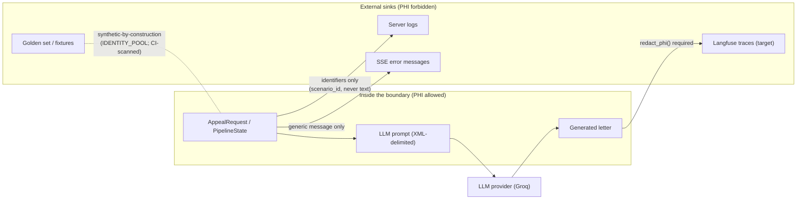

# 07 — Security Architecture: PHI Boundary & Threat Model

*Verified against source 2026-07-02 (branch `project-review-hardening`).
Companion docs: [/docs/backend-security-debt.md](../backend-security-debt.md)
(debt history), [/docs/golden-set-governance.md](../golden-set-governance.md)
(data classification), CLAUDE.md §Security Defaults + §Dependency Security
(the rules). This doc maps the controls to the architecture.*

## PHI boundary

PHI may live **inside** the process (requests, pipeline state, prompts sent
to the configured LLM provider). It must never leave via **side channels** —
logs, traces, error messages, fixtures.

Controls at each sink:

- **Logs:** pipeline logging records identifiers only (`scenario_id`) —
  never request or letter text. Any text that touched a denial letter or
  patient record must pass `redact_phi()`
  ([backend/security/redact.py](../../backend/security/redact.py)) first:
  deterministic regex scrub of SSN, MRN (`PH-\d+`), DOB, `First M. Last`
  (hard-7), and two-word Title-Case names. Known trade-off: over-redacts
  Title-Case prose ("Medical Director") — acceptable for logs; revisit
  before any Langfuse text processing.
- **SSE errors:** clients get generic messages; detail stays server-side
  (hard-2).
- **Golden set:** synthetic-by-construction — identities come only from the
  closed `IDENTITY_POOL`; `tests/unit/test_golden_compliance.py` scans for
  PHI-shaped content and fixture drift as a CI gate.
- **LLM provider:** sending the prompt to the configured provider is a
  deliberate, visible data flow (the `LLM_BACKEND` decision). `mock` keeps
  everything in-process.

## Untrusted-input defenses (documents)

Layered along ETL Flow 1 (diagram in [04-data-flow.md](04-data-flow.md)):

| Layer | Defense | Code |
| --- | --- | --- |
| Size/type | 5 MB cap; magic-byte detection (never filename); rejects `MZ`/`ELF`/`PK` outright | [pipeline.py](../../backend/etl/denial_letter/pipeline.py), [file_detector.py](../../backend/etl/denial_letter/file_detector.py) |
| Text hygiene | Null-byte strip; bidi overrides flagged + removed; zero-width chars removed; NFKD homoglyph normalization with low-ratio non-ASCII flagging | [sanitize.py](../../backend/security/sanitize.py) `sanitize_extracted_text` |
| Injection phrases | Pattern list ("ignore previous instructions", "reveal system prompt", …) — **always** scanned, even when an earlier check already flagged, so combined attacks surface fully (fixed in backend-security-debt) | same |
| Hidden PDF text | PhantomLint-style scan of the raw content stream for white-fill + text-draw operator pairs; an **unreadable page is itself flagged** (`confidence 0.5`, hard-6) — conservative direction, routes to human review | [sanitize.py](../../backend/security/sanitize.py) `ocr_consistency_check` |
| Enforcement | Any flag ⇒ `security_hold=True` on the `AppealRequest`; the pipeline gate terminates held requests before any node — the LLM is never invoked (hard-1) | [graph.py](../../backend/agents/graph.py) |
| Prompt containment | Untrusted text enters the prompt only inside `<pa_requirements>` / `<denial_letter>` XML slots — never raw interpolation | [prompts.py](../../backend/agents/prompts.py) |

**Enforcement-pairing rule** (from the hardening review): every detection
flag must have exactly one downstream enforcement point, with a test proving
the pair. Detection without enforcement is how hard-1 happened.

## LLM-output defenses

The other untrusted input is the model itself
([ADR-0003](adr/0003-deterministic-gatekeeper.md)): deterministic gatekeeper
before any downstream use (length, drug, diagnosis, refusal/AI-identity
phrases), structural eval scores on the `DoneEvent`, and the
no-uncited-claim rule (CLAUDE.md §AI Output Accountability) whose full
claim→citation enforcement is golden-set `claim_citation` scorer work.

## Threat table (STRIDE-lite, by boundary)

| Boundary | Threat | Mitigation today | Gap / planned |
| --- | --- | --- | --- |
| Uploaded document | Prompt injection (visible text) | Injection-phrase scan → security hold | Phrase list is enumerable; redteam fixtures (`*_redteam`) exercise it |
| Uploaded document | Hidden-text injection (white text, bidi, zero-width, homoglyphs) | PhantomLint + sanitizer + conservative unreadable-page flag | Confidence heuristic, not proof; human review is the backstop |
| Uploaded document | Malicious file (executable, zip bomb) | Magic-byte rejection + 5 MB cap before any parser runs | OOXML unsupported by policy (rejected as `PK`) |
| API | Auth bypass | Bearer on all `/api/*`, middleware before body parse, `hmac.compare_digest` | Timing side-channel item deferred ([backend-security-debt](../backend-security-debt.md) item 3); CORS `*` to tighten at deploy; rate limiting (`slowapi`) deferred until internet-facing |
| LLM output | Uncited/hallucinated claims reaching a payer | Gatekeeper floor + structural scores + human review before submit | Claim→span faithfulness scorer (golden-set `claim_citation`) |
| LLM output | Refusal/identity leakage into a formal letter | `_REFUSAL_PATTERNS` gate + retry | Pattern list maintenance |
| Side channels | PHI in logs/traces/errors | Identifiers-only logging, `redact_phi`, generic client errors, golden-set CI scan | Langfuse re-vetting required before tracing lands ([ADR-0007](adr/0007-deferred-dependencies.md)) |
| Supply chain | Malicious/vulnerable package | CLAUDE.md pre-install protocol; `pip-audit` fails CI; `npm audit`; pinned CVE floors (`urllib3>=2.7.0`); deferred-deps rule | Human vigilance on the protocol itself |
| External provider | Degraded/hostile dependency | 30s timeout, 2 bounded retries, circuit breaker (3 failures → 30s cooldown) | — |

## Standing invariants

1. A flagged document never reaches the LLM.
2. PHI never leaves via a side channel unredacted.
3. LLM output never reaches a payer-facing artifact without passing the
   deterministic gate and human review.
4. Every stream terminates with a typed event — failures are visible, never
   swallowed.
5. No package enters the tree without the pre-install protocol.

Any change that weakens one of these needs an ADR, not just a PR.
