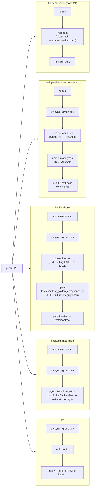
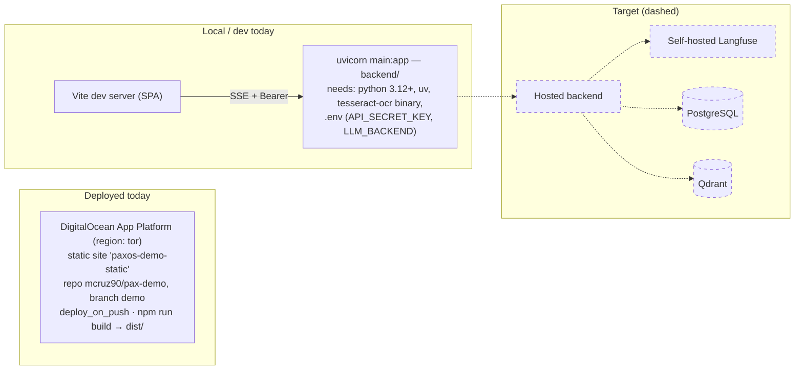

# 08 — Deployment & CI

*Verified against source 2026-07-02 (branch `project-review-hardening`).
Sources: [.github/workflows/ci.yml](../../.github/workflows/ci.yml),
[app.yaml](../../app.yaml), [backend/pyproject.toml](../../backend/pyproject.toml).*

## CI pipeline

Runs on every push (all branches) and PRs to `main`. Five parallel jobs; all
are gates — no `|| true` escape hatches (chore-12 removed the pip-audit one).

Gate semantics worth knowing:

- **`pip-audit` is a supply-chain gate**, not advisory — a CVE in the
  dependency tree fails the build (CLAUDE.md §Dependency Security,
  [ADR-0007](adr/0007-deferred-dependencies.md)).
- **The golden-compliance scan runs before the main test suite** so a
  poisoned/PHI-bearing fixture fails loudly and early.
- **Parity guards run in CI**, not just on dev machines — frontend
  `scenarios_parity.test.ts` in the Vitest job, backend
  `test_schema_parity.py` in the unit job.
- **`wire-types-freshness` is a drift gate for the wire contract** (ADR-0012).
  It regenerates `openapi.json` (from the live Pydantic models) and
  `src/generated/api-types.d.ts`, then fails on any diff — so the checked-in
  generated types can never silently lag the backend schema. It needs both
  toolchains (Node for `openapi-typescript`, uv/Python for the OpenAPI dump).
  Note: a scoped `overrides` entry in `package.json` pins `openapi-typescript`'s
  `typescript` peer to the root version (a TS-6 peer-range lag) — chosen over a
  repo-wide `legacy-peer-deps` so peer validation stays on elsewhere; remove
  once upstream widens the range (ADR-0012).
- **The live-LLM eval CLI is deliberately not in CI** (needs a provider key,
  costs tokens) — planned as `evals/run_evals.py` (Sprint 4), manual or
  `workflow_dispatch`.
- Playwright E2E is **not** in CI (and currently 10/13 failing — see
  [09-test-architecture.md](09-test-architecture.md)).

## Runtime topology

Only the **demo SPA** is deployed (`demo` branch, auto-deploy on push,
[ADR-0005](adr/0005-dual-branch-strategy.md)). The backend runs locally; no
hosted backend exists yet. System-level dependency: the Tesseract 5.x binary
(`tesseract-ocr`) for `pytesseract` — installed via apt in CI, must be
present wherever the backend runs.

## Environment matrix

| Environment | `LLM_BACKEND` | Keys needed | Network calls | Purpose |
| --- | --- | --- | --- | --- |
| Local dev | `mock` | `API_SECRET_KEY` only | none | Full pipeline behavior, deterministic letters |
| CI | `mock` (integration tests construct it directly) | none (no secrets in CI) | none | Gates above |
| Live demo / manual eval | `groq` | `API_SECRET_KEY`, `GROQ_API_KEY` | Groq API only | Real generation |
| Deployed SPA | n/a (static) | `VITE_API_KEY` baked at build if pointing at a live backend | optional | Portfolio demo — runs offline on fixtures by default |

Full env-var reference: [06-api-contract.md](06-api-contract.md#environment-variables).

## Deploy-time checklist (when a hosted backend lands)

Collected from in-code flags and CLAUDE.md rules — these are the known
"tighten in production" items:

1. CORS `allow_origins=["*"]` → explicit origin list (`main.py`).
2. Rate limiting (`slowapi`, deferred) once internet-facing.
3. Bearer-token timing side-channel item
   ([backend-security-debt](../backend-security-debt.md) item 3).
4. Langfuse only after re-vetting its network behavior (PHI codebase,
   [ADR-0007](adr/0007-deferred-dependencies.md)); traces best-effort,
   never blocking generation.
5. Durability rule: AuditRecord persisted before the SSE `done` event
   (CLAUDE.md §ACID) — PostgreSQL milestone.
