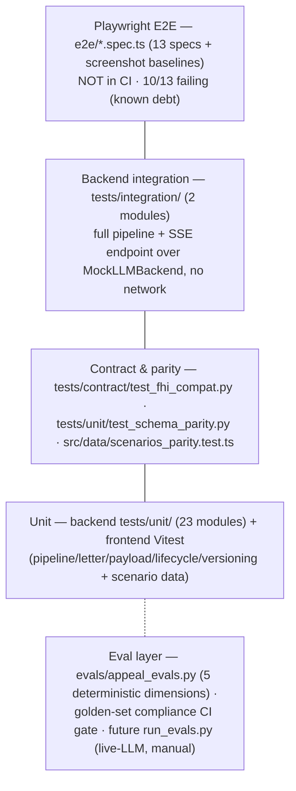

# 09 — Test Architecture

*Verified against source 2026-07-02 (branch `project-review-hardening`).*

Testing follows CLAUDE.md TDD: a failing test **before** production code
(Red → Green → Refactor, committed separately — see the `test(hard-N): RED` /
`fix(hard-N): GREEN` commit pairs on the hardening branch). Spec-first is the
same rule for shapes: the Pydantic schema changes first, the test verifies
behavior against it.

## Tiers

### Backend unit (`backend/tests/unit/`, 23 modules)

One module per unit of behavior, mirroring the layer map: the four nodes
(`test_ingestion_node`, `test_retrieval_node`, `test_synthesis_node`,
`test_gatekeeper_node`), API boundary (`test_auth_middleware`,
`test_input_validation`), security (`test_phi_redact`,
`test_prompt_injection`), providers (`test_llm_backend` — CircuitBreaker
contract, Protocol conformance), ETL (`test_etl_denial_pipeline`,
`test_etl_code_extractor`, `test_etl_field_confidence`), golden set
(`test_golden_generator`, `test_golden_fetcher`, `test_golden_compliance`,
`test_adversarial_fixtures`, `test_regulatory_rules`), fixtures/evals
(`test_scenarios_fixture`, `test_fixtures_adapter`, `test_appeal_evals`,
`test_eval_enrichment`), and schema shape (`test_schema_parity`,
`test_case_packet_schema`).

Nodes are pure `(state) → state` functions, so unit tests use literal inputs
and plain assertions — no mocked DB, no cross-node setup (the CLAUDE.md
"where business logic lives" rule is what makes this tier cheap).

### Shared fixtures (`backend/tests/conftest.py`)

`mock_llm`, `base_scenario` / `exception_scenario` (built **from the golden
fixtures via the adapter** — never restated inline, per
[ADR-0004](adr/0004-golden-set-canonical-dataset.md)),
`base_appeal_request`, `make_pipeline_state` factory, criterion fixtures.
Note: conftest's `MockLLMBackend` is a *test* double; `ml/mock_backend.py`
is a *production* module — same interface, deliberately separate.

### Integration (`backend/tests/integration/`)

`test_pipeline.py` (full 4-node run, retry paths, security hold) and
`test_sse_endpoint.py` (HTTP + auth + SSE frame parsing + event ordering +
terminal-event guarantee). No network, no keys — runnable anywhere.

### Contract & parity

The drift gates: `test_fhi_compat.py` pins the forked
`third_party/fhi/` surface; `test_schema_parity.py` pins backend enum shapes
(hard-3); `scenarios_parity.test.ts` pins frontend scenario data against the
anchors. All three run in CI ([08-deployment-ci.md](08-deployment-ci.md)).

### Frontend (Vitest)

Logic extracted from the component tree gets unit tests
(`src/components/poc/pipeline.test.ts`, `letter.test.ts`,
`payload.test.ts`, `src/components/lifecycle.test.ts`,
`versioning.test.ts`, `src/components/portfolio/caseQueue.test.ts`,
`src/data/patientContext.test.ts`) — per the CLAUDE.md rule that extraction
implies a test. Components themselves are demo-only and E2E-covered.

### E2E (Playwright, `e2e/`)

13 specs over user journeys (landing, queue, case, build, tours) with
screenshot baselines in `e2e/__screens__/`. **Known debt:** 10/13 fail after
the landing-hub redesign removed their entry points; deferred pending a UX
decision — details and reproduction in
[/docs/frontend-e2e-debt.md](../frontend-e2e-debt.md). Not a CI gate today
(deliberate: they'd redline every build until the UX decision lands).

## The eval layer is a separate tier, on purpose

Evals answer "is the *output* good," tests answer "does the *code* behave" —
and per [ADR-0003](adr/0003-deterministic-gatekeeper.md) neither may be a
prompt back to the generating model.

- **In-pipeline:** `eval_structural` scores every successful run on 5
  deterministic dimensions; emitted on `DoneEvent`, informational.
- **CI gate:** `test_golden_compliance.py` — PHI scan + fixture integrity
  over the golden set, runs before the main suite.
- **Manual/planned:** live-LLM regression runs (`evals/run_evals.py`,
  Sprint 4) against the golden set's labeled dimensions
  (coverage / structure / safety / claim_citation / over_caution), including
  redteam scenarios asserting *defensive* behavior (security hold fires, PHI
  stays in). Excluded from CI by design (cost, keys).

## Independent verification rule

Passing tests you just wrote is necessary, not sufficient: for non-trivial
features the verification step is an independent review pass
(`/code-review`), per CLAUDE.md §Defensive Programming. The hardening review
itself ([/docs/project-review-hardening.md](../project-review-hardening.md))
is the standing example — it found six "built and tested but never wired in"
gaps that green suites didn't catch.

## Adding a feature — the expected test shape

1. Schema first (`models/schemas.py` + parity mirror if shared).
2. RED: failing unit test against the schema'd contract; fixture data comes
   through `fixtures_adapter`, never inline.
3. GREEN: minimal implementation; separate commit.
4. Integration test only if the feature crosses a boundary (new route, new
   node edge, new event).
5. If it changes structure or a contract: update the relevant doc here and
   ADR it if a decision was made.
