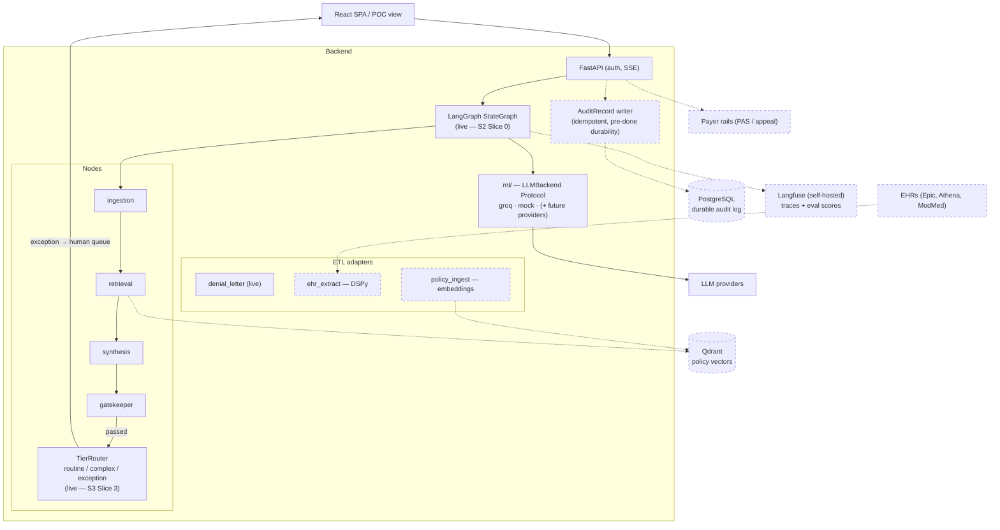

# 10 — Target Architecture & Roadmap Traceability

*Written 2026-07-02. This is the forward-looking doc — everything here is
**target** unless marked live. Sprint planning starts here: find the roadmap
item, see which components and ADRs it touches, check the dependency
re-entry cost. The sequenced, slice-level plan is
[11-sprint-plan.md](11-sprint-plan.md).*

## Target-state container view

Solid = live today. Dashed = target.

The platformization thesis behind the dashed pieces: **adapters translate
every source (payer, EHR, document) into the canonical schema; one shared
engine runs on canonical data; onboarding a client becomes configuration,
not code** — the demo UI's Build/Scale views already tell this story; the
backend earns it milestone by milestone.

## Traceability map

| Roadmap item | Components touched | Deps to re-vet ([ADR-0007](adr/0007-deferred-dependencies.md)) | Docs/ADRs to update | Status |
| --- | --- | --- | --- | --- |
| **LangGraph migration** (Sprint 2 **Slice 0** — resequenced 2026-07-02) | `agents/graph.py` → `StateGraph(PipelineState)`; `run_pipeline` signature + SSE contract unchanged; nodes untouched | `langgraph`, `langchain-core>=1.3.3` | [02](02-backend-architecture.md); executes [ADR-0001](adr/0001-langgraph-target-orchestrator.md) | **Live** (2026-07-02, S2 Slice 0 — suite passed unmodified) |
| **Sprint 2 — Initial-PA lifecycle** | `models/schemas.py` (lifecycle fields exist; new lifecycle-named request — NOT an `AppealRequest` extension), new nodes/routes for CRD→DTR→PAS flow, `CasePacket` wiring | via Slice 0 above | [03](03-domain-model.md), [05](05-state-lifecycle.md), [06](06-api-contract.md) | **Live** (2026-07-03, S2 Slices 1–5: `InitialPaRequest`, CRD/assembly nodes, stub PAS rail + determination, `/api/pa/submit`; stretch upload route not done) |
| **AuditRecord wiring** (with Sprint 2) | Pipeline boundary writes in-memory `list[AuditRecord]`; provenance field (as-is / gatekeeper-corrected / human-edited); idempotency key = `case_id` + attempt | none | [03](03-domain-model.md), [06](06-api-contract.md), [ADR-0009](adr/0009-idempotency-key-and-audit-writes.md) | **Live** (2026-07-03, S2 Slice 4 — both lifecycles, every terminal) |
| **TierRouter / HITL tiering** (Sprint 3) | New `agents/nodes/tier_router.py` (deterministic, never LLM-decided); `CriterionResult.confidence` first (spec-first, ripples to frontend); `CaseTier` becomes a backend enum | none (LangGraph already in from S2 Slice 0) | [02](02-backend-architecture.md), [03](03-domain-model.md), [05](05-state-lifecycle.md) | In progress — `CriterionResult.confidence` **Live** (2026-07-03, S3 Slice 1: schema + types.ts mirror + field parity + adapter + golden labels); `tier_router.py` + `CaseTier` backend enum **Live** (2026-07-03, S3 Slice 2); wiring **Live** (2026-07-04, S3 Slice 3 — gatekeeper-pass edge `gatekeeper → tier_router → finalize`, `tier` on `DoneEvent`/`AuditRecord`; exhausted path carries no tier; frontend already keys review UI off `getCaseTier`); exception interrupt foundation **Live** (2026-07-04, S3 Slice 4a — `InMemorySaver` + `hold` node parks exception runs at `interrupt()`, `thread_id = correlation_id`, done|error preserved; [ADR-0010](adr/0010-in-memory-checkpointer-exception-interrupt.md)); resume endpoint **Live** (2026-07-04, S3 Slice 4b — `POST /api/appeal/resume` → `run_resume`, `resume_finalize` node, distinct `human_edited` audit record per the [ADR-0009 resume amendment](adr/0009-idempotency-key-and-audit-writes.md)). **Sprint 3 closes here (2026-07-04):** the backend/API HITL story is complete; Slice 4c (frontend resume UX) **deferred** to the frontend↔backend live-integration workstream ([11](11-sprint-plan.md) Unscheduled) — the POC has no live backend wiring yet |
| **Live-LLM eval CLI** (Sprint 4) | `evals/run_evals.py`; golden-set dimension scorers (claim_citation etc.) | none (uses existing provider) | [09](09-test-architecture.md) | Planned; never in CI |
| **Qdrant policy retrieval** (Phase 1.2 / S5) | `etl/policy_ingest/`; retrieval node gains vector path; coverage-driven resolution (BIN/PCN/Group via `golden/coverage_pool.json`) | `qdrant-client`, `sentence-transformers` | [02](02-backend-architecture.md), [04](04-data-flow.md), new ADR (vector store choice) | Planned — S5 hook comments already in code |
| **DSPy EHR extraction** (Phase 1.3) | `etl/ehr_extract/`; new adapter → `CasePacket` | `dspy` | [04](04-data-flow.md) | Planned — dir stub exists |
| **Langfuse observability** | Trace emission at graph boundary; `redact_phi` on all payloads; best-effort try/except (never blocks generation); correlation IDs end-to-end | `langfuse` (re-vet network behavior — PHI) | [07](07-security-architecture.md), [08](08-deployment-ci.md) | Deferred |
| **PostgreSQL durable audit** (Phase 3) | AuditRecord persistence **before** SSE `done` (ACID §Durability); replaces in-memory list | driver TBD (new ADR) | [03](03-domain-model.md), [08](08-deployment-ci.md) | Deferred |
| **Hosted backend** | Deploy target; CORS tightening, rate limiting (`slowapi`), timing-side-channel fix | `slowapi` | [08](08-deployment-ci.md) checklist | Deferred |
| **Payer/EHR connectors** | New `etl/` adapters per source → canonical schema; rail-accurate transmission (PAS vs appeal channel) | per-connector | [01](01-system-overview.md), [04](04-data-flow.md), ADRs per rail | Direction (platformization) |
| **Frontend ↔ backend live integration** (absorbs S3 Slice 4c) | First live API calls from the SPA: generated wire types from OpenAPI, session-cookie BFF auth (FastAPI is its own BFF; Bearer stays for services), typed POST-SSE client, live POC wiring behind a `VITE_API_BASE_URL` mode seam (simulated stays default) | `openapi-typescript` (dev-only, vetted per §Dependency Security) | [06](06-api-contract.md), [07](07-security-architecture.md), [ADR-0011](adr/0011-audit-trail-as-review-queue-index.md), [ADR-0012](adr/0012-generated-wire-types-from-openapi.md), [ADR-0013](adr/0013-fastapi-bff-session-cookie-auth.md) | **Sprint FI in progress** ([11](11-sprint-plan.md)) — prep + Slices 1–3 **Live** (2026-07-08/09: introspection endpoints + review-queue index, wire types + freshness gate, session auth + `reviewed_by`, SSE client); Slice 4 (live POC wiring = the original 4c) in progress 2026-07-09 |
| **Frontend post-demo split** | `App.tsx` → `components/` + `hooks/`; `scenarios.tsx` → per-anchor files | none | [01](01-system-overview.md) | Documented debt (CLAUDE.md) |
| **E2E unblock** | Landing-hub UX decision, then re-point 10 specs | none | [09](09-test-architecture.md) | Blocked on UX decision ([frontend-e2e-debt](../frontend-e2e-debt.md)) |
| **Evidence discovery rail** (unit O6) | `/api/discovery/*`: retrieval over case evidence (guidelines/PubMed/EHR-verify) + doc Q&A; natural home beside S5 policy retrieval | `qdrant-client`, `sentence-transformers` (shared with S5 re-vet) | [02](02-backend-architecture.md), [06](06-api-contract.md), new ADR | Proposed 2026-07-17 — demo rail shipped (fixture-honest `EvidenceDiscoveryConsole`); no backend |
| **Outbound dispatch rail** (gap G7 / unit O11) | Transmission adapter for provider-facing requests (fax / EHR task), `workflowPlan` producer, awaiting-documentation lifecycle handling; adapter pattern like the PAS stub | per-channel | [04](04-data-flow.md), [05](05-state-lifecycle.md), new ADR | Proposed 2026-07-17 — demo dispatch + activity-log artifact snapshot shipped; no backend |
| **Device/procedure PA generalization** (`PaTargetType`) | Domain model beyond medication-shaped requests (drug/NDC): target-typed PA lifecycles in `models/`, retrieval, rails | none yet | [03](03-domain-model.md), new ADR | Proposed 2026-07-17 — frontend type + display shipped (demo history shows a CGM device PA); backend untouched |
| **PHI tokenizer + LLM-seam leak gate** (P9a; ADR-0014 as amended) | `etl/` identifier tokenizer (typed tokens, separate encrypted token map); rehydration helper at letter finalization only; deterministic leak gate at `ml/llm_backend` blocking prompts with identifier hits | none | [07](07-security-architecture.md), [12](12-phi-data-planes.md) | Committed by ADR-0014 acceptance (2026-07-17); lands with the ETL upload route (S5 owns the route) |
| **NER de-id sidecar** (P9b; ADR-0014 amendment) | Self-hosted healthcare-NER sidecar service scanning tokenized text for residual free-text identifiers (detector only — masked/quarantined, never rehydrated) | NER model + weights (full dependency/model vetting; safetensors; isolated container) | [07](07-security-architecture.md), [12](12-phi-data-planes.md) | Committed by ADR-0014 acceptance; gated on model vetting + a de-identification eval (planted-identifier recall on the golden set) |
| **Tenancy / user→patient assignment** (gap G1; P7) | Tenant→org→user→patient-panel model; session gains role + tenant claim; `/api/audit/records` + `/api/reviews/pending` become tenant-scoped | none (design spike first) | [03](03-domain-model.md), [ADR-0017](adr/0017-tenancy-patient-assignment.md) (P7 deliverable) | Spike delivered 2026-07-18 — ADR-0017 **Proposed**, awaiting May's review; no code until accepted |
| **Single-shell migration** (X5; Workstream SU) | `src/capabilities.ts` manifest (`unit → live \| simulated \| hidden`); session gate + live units composed into the portfolio shell; `LiveApp` demoted to `?console=dev` and emptied unit-by-unit | none | [11](11-sprint-plan.md) §Workstream SU, [13](13-capability-manifest.md), [ADR-0016](adr/0016-single-shell-capability-manifest.md), [ADR-0005 amendment](adr/0005-dual-branch-strategy.md) | **Decided + started 2026-07-17** — Slice 1 (O5 resume, O7 pending queue, B8 audit trail behind the manifest) in progress |
| **Break-glass PHI access** (gap G5 / unit O13) | Named user + recorded justification + time-boxed reveal; new `AuditRecord` reason class; Operate/Build UI flow | none | [07](07-security-architecture.md), [12](12-phi-data-planes.md) | Committed by ADR-0014 acceptance; sequenced after tenancy (needs a user to attribute) |

## Standing invariants for all future work

These carry over regardless of which row lands next:

1. **Adapters at the edge, canonical schema inside** — engine code never
   branches on payer/EHR/source format.
2. **Nodes stay `(state) → state` pure** — this is what keeps ADR-0001's
   migration cheap and the test pyramid standing.
3. **Detection pairs with enforcement** — a new flag ships with its
   downstream enforcement point and a test proving the pair.
4. **New deps go through the pre-install protocol** — deferral is not
   pre-approval.
5. **Structural change ⇒ doc change in the same PR** — this suite decays
   into fiction otherwise ([README](README.md#keeping-these-current)).
