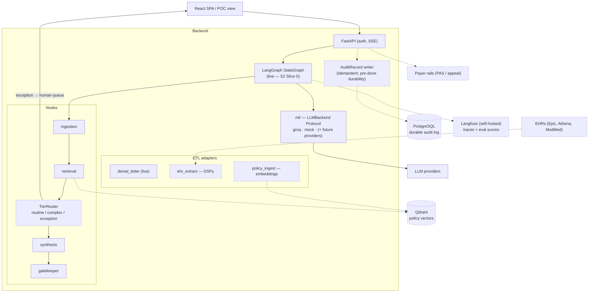

# 10 — Target Architecture & Roadmap Traceability

*Written 2026-07-02. This is the forward-looking doc — everything here is
**target** unless marked live. Sprint planning starts here: find the roadmap
item, see which components and ADRs it touches, check the dependency
re-entry cost. The sequenced, slice-level plan is
[11-sprint-plan.md](11-sprint-plan.md).*

## Target-state container view

Solid = live today. Dashed = target.

The platformization thesis behind the dashed pieces: **adapters translate
every source (payer, EHR, document) into the canonical schema; one shared
engine runs on canonical data; onboarding a client becomes configuration,
not code** — the demo UI's Build/Scale views already tell this story; the
backend earns it milestone by milestone.

## Traceability map

| Roadmap item | Components touched | Deps to re-vet ([ADR-0007](adr/0007-deferred-dependencies.md)) | Docs/ADRs to update | Status |
| --- | --- | --- | --- | --- |
| **LangGraph migration** (Sprint 2 **Slice 0** — resequenced 2026-07-02) | `agents/graph.py` → `StateGraph(PipelineState)`; `run_pipeline` signature + SSE contract unchanged; nodes untouched | `langgraph`, `langchain-core>=1.3.3` | [02](02-backend-architecture.md); executes [ADR-0001](adr/0001-langgraph-target-orchestrator.md) | **Live** (2026-07-02, S2 Slice 0 — suite passed unmodified) |
| **Sprint 2 — Initial-PA lifecycle** (next) | `models/schemas.py` (lifecycle fields exist; new lifecycle-named request — NOT an `AppealRequest` extension), new nodes/routes for CRD→DTR→PAS flow, `CasePacket` wiring | via Slice 0 above | [03](03-domain-model.md), [05](05-state-lifecycle.md), [06](06-api-contract.md) | Planned — slices in [11](11-sprint-plan.md) |
| **AuditRecord wiring** (with Sprint 2) | Pipeline boundary writes in-memory `list[AuditRecord]`; provenance field (as-is / gatekeeper-corrected / human-edited); idempotency key = `case_id` + attempt | none | [03](03-domain-model.md), [06](06-api-contract.md), [ADR-0009](adr/0009-idempotency-key-and-audit-writes.md) | **Live** (2026-07-03, S2 Slice 4 — both lifecycles, every terminal) |
| **TierRouter / HITL tiering** (Sprint 3) | New `agents/nodes/tier_router.py` (deterministic, never LLM-decided); `CriterionResult.confidence` first (spec-first, ripples to frontend); `CaseTier` becomes a backend enum | none (LangGraph already in from S2 Slice 0) | [02](02-backend-architecture.md), [05](05-state-lifecycle.md) | Planned — slices in [11](11-sprint-plan.md) |
| **Live-LLM eval CLI** (Sprint 4) | `evals/run_evals.py`; golden-set dimension scorers (claim_citation etc.) | none (uses existing provider) | [09](09-test-architecture.md) | Planned; never in CI |
| **Qdrant policy retrieval** (Phase 1.2 / S5) | `etl/policy_ingest/`; retrieval node gains vector path; coverage-driven resolution (BIN/PCN/Group via `golden/coverage_pool.json`) | `qdrant-client`, `sentence-transformers` | [02](02-backend-architecture.md), [04](04-data-flow.md), new ADR (vector store choice) | Planned — S5 hook comments already in code |
| **DSPy EHR extraction** (Phase 1.3) | `etl/ehr_extract/`; new adapter → `CasePacket` | `dspy` | [04](04-data-flow.md) | Planned — dir stub exists |
| **Langfuse observability** | Trace emission at graph boundary; `redact_phi` on all payloads; best-effort try/except (never blocks generation); correlation IDs end-to-end | `langfuse` (re-vet network behavior — PHI) | [07](07-security-architecture.md), [08](08-deployment-ci.md) | Deferred |
| **PostgreSQL durable audit** (Phase 3) | AuditRecord persistence **before** SSE `done` (ACID §Durability); replaces in-memory list | driver TBD (new ADR) | [03](03-domain-model.md), [08](08-deployment-ci.md) | Deferred |
| **Hosted backend** | Deploy target; CORS tightening, rate limiting (`slowapi`), timing-side-channel fix | `slowapi` | [08](08-deployment-ci.md) checklist | Deferred |
| **Payer/EHR connectors** | New `etl/` adapters per source → canonical schema; rail-accurate transmission (PAS vs appeal channel) | per-connector | [01](01-system-overview.md), [04](04-data-flow.md), ADRs per rail | Direction (platformization) |
| **Frontend post-demo split** | `App.tsx` → `components/` + `hooks/`; `scenarios.tsx` → per-anchor files | none | [01](01-system-overview.md) | Documented debt (CLAUDE.md) |
| **E2E unblock** | Landing-hub UX decision, then re-point 10 specs | none | [09](09-test-architecture.md) | Blocked on UX decision ([frontend-e2e-debt](../frontend-e2e-debt.md)) |

## Standing invariants for all future work

These carry over regardless of which row lands next:

1. **Adapters at the edge, canonical schema inside** — engine code never
   branches on payer/EHR/source format.
2. **Nodes stay `(state) → state` pure** — this is what keeps ADR-0001's
   migration cheap and the test pyramid standing.
3. **Detection pairs with enforcement** — a new flag ships with its
   downstream enforcement point and a test proving the pair.
4. **New deps go through the pre-install protocol** — deferral is not
   pre-approval.
5. **Structural change ⇒ doc change in the same PR** — this suite decays
   into fiction otherwise ([README](README.md#keeping-these-current)).
