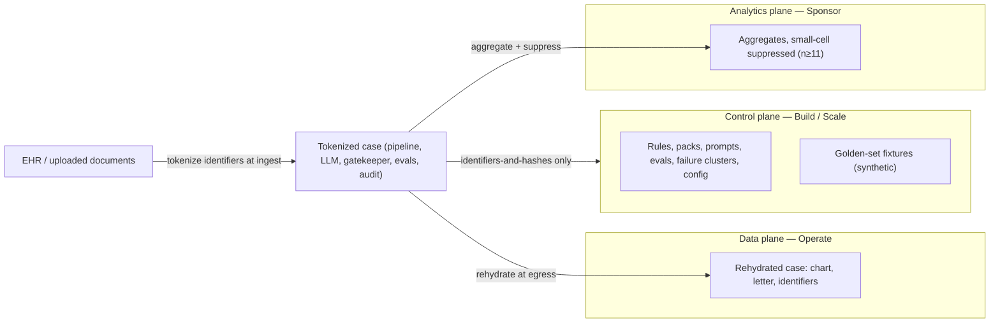

# 12 — PHI Data Planes: Persona × Data-Class Matrix

*Companion to [ADR-0014](adr/0014-phi-visibility-planes-tokenization.md)
(Accepted 2026-07-17, as amended — this doc describes the **target** posture;
the enforced pre-DB controls remain those in
[07-security-architecture.md](07-security-architecture.md) until P9a/P9b land).
Every UI unit inherits its PHI posture from the persona plane it lives in —
see [/docs/design/ui-unit-exploration.md](../design/ui-unit-exploration.md).*

## The three planes

The tokenization boundary sits at ETL ingest; rehydration happens only at
the Operate rendering path and final letter assembly/transmission. Between
those two edges, the system's working object is the tokenized case.

## Persona × data-class matrix

| Data class | Operate (clinician / PA coordinator) | Build (Applied AI lead) | Scale (implementation lead) | Sponsor (manufacturer analyst) |
| --- | --- | --- | --- | --- |
| Direct identifiers (name, DOB, MRN, member ID) | ✅ Rehydrated, **own patients only** (tenancy-scoped) | ⛔ Masked ref (`PT-XXXX`) · break-glass exception | ⛔ Never (no patient-level objects) | ⛔ Never |
| Clinical facts (diagnosis, labs, meds, notes) | ✅ Full | 🟡 Redacted artifacts; golden-set repro preferred | ⛔ Never | ⛔ Never (aggregate only) |
| Generated letters / PA artifacts | ✅ Full (their cases) | 🟡 Tokenized/redacted text; hashes by default | ⛔ Never | ⛔ Never |
| Audit records (ids, hashes, scores, provenance) | ✅ Their cases | ✅ All (already identifiers-and-hashes by design) | ✅ Tenant-level | ⛔ Only as aggregates |
| Rules / packs / prompts / eval rubrics | 🟡 Read (context for a case) | ✅ Full CRUD (eval-gated promotion) | ✅ Read + tenant config | ⛔ — |
| Connector / tenant configuration | ⛔ — | 🟡 Read | ✅ Full | ⛔ — |
| Aggregate market analytics | 🟡 Own-org quality metrics | ✅ Cross-run eval aggregates | ✅ Per-tenant health | ✅ Suppressed aggregates (no n<11 cells) |
| Legal basis | Treatment / operations on own patients | Product ops — minimum necessary | Product ops — no patient-level need | Commercial analytics — never patient-level |

✅ full access · 🟡 restricted form stated in the cell · ⛔ no access path exists

## Enforcement points

| Control | Target (ADR-0014) | Enforced today (pre-DB) |
| --- | --- | --- |
| Identifier tokenization | ETL ingest, before pipeline state | Not yet — lands with the ETL upload route (S5) |
| Rehydration | Egress only (Operate views, letter assembly) | N/A until tokenizer exists |
| Side-channel redaction | Unchanged | ✅ `redact_phi()` before logs; audit = ids + hashes; SSE errors generic |
| Control-plane object model | PHI-free by construction | ✅ Build/Scale views are fixture/config-derived |
| Break-glass | Named user + justification + time-box + audit record | Does not exist — roadmap |
| Tenancy (user→patient) | Prerequisite for data plane | Does not exist — roadmap |
| Small-cell suppression | Sponsor query layer | Demo fixtures only (no live sponsor data) |

## What this doc is for

When a new view, endpoint, or export is proposed, answer two questions from
the matrix: **which plane does it live in**, and **does its data class have a
✅/🟡 in that persona's column**? If the answer requires a new ⛔→🟡
transition, that is an ADR-0014 amendment, not a view-level decision.
